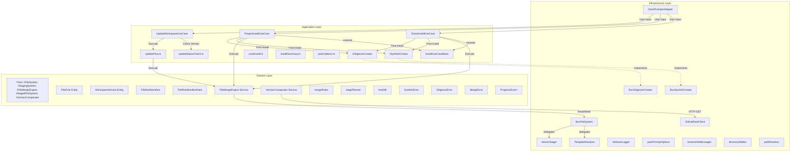

# Architecture – Códice: Opencode Workspace Installer

## Overview
Códice follows Clean Architecture with strict layer boundaries. Dependencies point inward: Infrastructure → Application → Domain.

## Architecture Decision Records (ADRs)

| ADR | Title | Status | Key Decision |
|-----|-------|--------|--------------|
| [ADR-001](adr/adr-001-clean-architecture.md) | Clean Architecture | Accepted | 4-layer structure with dependency rule |
| [ADR-002](adr/adr-002-bun-compilation.md) | Bun as Runtime/Compiler | Accepted | Bun as runtime and compiler |
| [ADR-003](adr/adr-003-atomic-staging.md) | Atomic File Operations | Accepted | Staging + rename pattern |
| [ADR-004](adr/adr-004-clack-prompts.md) | TUI with @clack/prompts | Accepted | Lightweight interactive prompts |
| [ADR-005](adr/adr-005-dest-flag-and-workspace.md) | `--dest` Flag and Workspace Directory | Accepted | Safe dev playground via `--dest` + `tests/fixtures/workspace/` |
| [ADR-006](adr/adr-006-npm-publication.md) | npm Publication as Primary Distribution | Accepted | `bunx @fisherk2-dev/codice` as primary distribution method |
| [ADR-007](adr/adr-007-template-resolver-source-mode.md) | Template Resolution for bunx/npm Mode | Accepted | Three-path detection cascade (source, bunx/npm, cwd) |
| [ADR-008](adr/adr-008-symlink-post-install.md) | Post-Installation Symlink Generation | Accepted | ISymlinkCreator port + BunSymlinkCreator adapter for npm-compatible symlinks |
| [ADR-009](adr/adr-009-gitignore-post-install.md) | Post-Installation Gitignore Generation | Accepted | IGitignoreCreator port + BunGitignoreCreator adapter for npm-compatible gitignore generation |
| [ADR-010](adr/adr-010-no-template-copy-flag.md) | noTemplateCopy Flag for Virtual Manifest Entries | Accepted | `noTemplateCopy?` field on FileRule for entries whose content is generated post-installation (e.g., `.devin/` symlinks) |
| [ADR-011](adr/adr-011-binary-removal.md) | Binary Removal | Accepted | npm/bunx as sole distribution; binary compilation removed |
| [ADR-012](adr/adr-012-references-co-location.md) | References Co-location | Accepted | References co-located with skills, exposed via `references` section |
| [ADR-014](adr/adr-014-agent-pack-system.md) | Agent Pack System | Accepted | Pack-based agent classification with 8 selectable packs + 2 mandatory |
| [ADR-015](adr/adr-015-installer-ux-v2.md) | Installer UX v2 | Accepted | Metadata-driven installer with pack selection and version-gated updates |
| [ADR-016](adr/adr-016-new-commands.md) | Slash Commands v2.1 | Accepted | 4 new commands (`/sync`, `/migrate`, `/deploy`, `/analyze`) with skill delegation |
| [ADR-018](adr/adr-018-agent-delegation.md) | Agent Delegation Protocol | Accepted | Analyze → Plan → Execute protocol for primary agents via `task()` |
| [ADR-019](adr/adr-019-cicd-hardening.md) | CI/CD Hardening | Accepted (amended 2026-11-18 — Phase 0) | SHA-pinned actions, branch protection, PR/issue templates, npm provenance; Phase 0 amendment: `paths-ignore` off `pull_request`, `docs` job, `security` promoted to a required check, local pre-commit door |
| [ADR-020](adr/adr-020-spec-modularization.md) | SPEC Modularization | Accepted | 441-line SPEC.md → index + sub-specs (recorded at ADR-020 as 44-line index + 8 sub-specs; measured 2026-11-18: 50-line index + 14 files in `specs/`) |
| [ADR-021](adr/adr-021-codemod-parser-and-placement.md) | Codemod Parser and Placement | Accepted | The validator is the normative V2 schema reader; the codemod parser stays frozen as one-shot verbatim-emit tooling |
| [ADR-022](adr/adr-022-sdd-plugin-removal-legacy-banner.md) | SDD Plugin Removal and Offline Legacy Deprecation Banner | Accepted | Plugin fully removed (FEV-30, crashes on V2 hosts); enforcement lives solely in `permissions:` deny-lists; offline legacy banner (`legacyBanner.ts`) warns ≤ 2.1.2 before the mode menu |
| [ADR-023](adr/adr-023-short-lived-release-branches.md) | Short-Lived `release/X.Y.Z` Branches for Stable Promotion | Accepted (amends ADR-019) | Stabilization commits land on a short-lived `release/X.Y.Z` branch; quality gates run on the publication tag; stable tag requires explicit human go-ahead |
| [ADR-024](adr/adr-024-mcp-explicit-disabled-schema.md) | Explicit `disabled` MCP Schema and 3-Server Active Default | Accepted | V2 schema `mcp.servers` + explicit `disabled` per server (7 servers); only context7, gitmcp and vercel-grep connect by default; tavily/firecrawl removed |
| [ADR-025](adr/adr-025-plugins-suministrados-en-latest.md) | Third-Party Plugins Shipped at `@latest` in the Workspace Payload | Accepted | The payload's six `@latest` plugins are an explicit, documented exception to the ADR-019 §1 pinning discipline (which stays in force for CI); version pinning tracked as TD-V2-111 |

> **Note:** ADR-013 (plugin auto-discovery) and ADR-017 (intent auto-discovery) were **retired in FEV-30** (#90) together with the SDD plugin — that is why they are missing from the numbering. [ADR-022](adr/adr-022-sdd-plugin-removal-legacy-banner.md) supersedes both as the register entry for plugin-era enforcement.

> **Note:** `TemplateResolver` and `AtomicStager` are extracted classes (not full ADRs). They are SRP-based refactorings of `BunFileSystem` that follow the existing ADR-003 (atomic staging) pattern.

> **Note (register location, FEV-31):** the ADR register now lives in `docs/adr/` — 23 numbered ADR files plus `adr-template.md` (measured 2026-11-18). The pre-FEV-31 register path no longer exists, so any link pointing there is stale; the table above and the links in `../AGENTS.md`, `../SPEC.md` and `MIGRATION.md` all resolve under `docs/adr/`.

> **Note (stabilization history):** commit `1941ed3` was an **INCOMPLETE** stabilization — it fixed the manifest/E2E references and left the gates green (1972 tests, 31/31 e2e) without closing any of the issue gaps. FEV-31 completed it on 2026-11-17 (1991 tests, 31/31 e2e, tsc 0); pre-launch review 2026-11-18 raised final gates to 2027/0, 31/31 e2e — those gates cleared the `v2.1.5-beta.1` tag (published under dist-tag `beta`); v2.1.5 stable is now **ready for deployment, not yet published** (`latest` remains at 2.1.4). Verdict and remaining-gap inventory: [`diagnosis/fix30-fev31-partial-issue-implementation.md`](diagnosis/fix30-fev31-partial-issue-implementation.md).

### SPEC.md Resolved Decisions Coverage

The seven decisions below are covered by the ADRs above or by their implementation. [SPEC.md](../SPEC.md) carries no decision inventory of its own — it defers resolved decisions to this register ("Resolved decisions are documented in the respective ADRs", SPEC.md:40):

| # | Decision | Covered By | Status |
|---|----------|------------|--------|
| 1 | Template Packaging Format | ADR-011 (Binary removal — template bundled with npm package) | Documented |
| 2 | Optional File Grouping in TUI | ADR-004 (Clack prompts, IUserPrompt supports grouped multiselect) | Documented |
| 3 | GitHub Authentication (unauthenticated only) | ADR-002 (cross-platform via Bun, no runtime deps needed) | Documented |
| 4 | Windows Path Handling (normalize to `/`) | ADR-002 (cross-platform via Bun) | Documented |
| 5 | Local Version Storage (`.codice-version` file) | ADR-005 (dest flag affects version file location) | Documented |
| 6 | Rollback on Partial Failure | ADR-003 (atomic staging + backup/rollback) | Documented |
| 7 | Update Notification in Other Modes (exclusive to Update) | Implemented per SPEC.md; version check only runs in UpdateWorkspaceUseCase | Implemented |

## Layer Diagram

## Layer Responsibilities

### Domain Layer (`src/domain/`)
- Pure business logic, zero external dependencies
- Domain ports (`src/domain/ports/`): IFileSystem, IStagingSystem, IFileMergeEngine, IStagedFileSystem, IVersionComparator
- Entities: FileRule, FileRuleManifest, FileRuleManifestData, WorkspaceVersion
- Services: FileMergeEngine, VersionComparator, mergeRules, stagePlanner, treeDiff
- Types: SymlinkError, GitignoreError, MergeError, ProgressEvent, errorTypeGuards
- Error handling via Result<T, Error>

### Application Layer (`src/application/`)
- Use cases orchestrate domain services
- Application ports (`src/application/ports/`): IGitHubClient, ISymlinkCreator, IGitignoreCreator + split prompt ports (2.1.3): `IUserPrompt` (interaction) extends `IMessageDisplay` (notices/errors) and `IProgressReporter` (spinners/progress). `IFileSystem`, `IStagingSystem`, `IFileMergeEngine`, `IStagedFileSystem` and `IVersionComparator` are declared in `src/domain/ports/`, not here
- Legacy deprecation: legacyBanner.ts (`isLegacyVersion`, `LEGACY_MAX_VERSION = "2.1.2"`, `LEGACY_BANNER_MESSAGE`) — single source consumed by the pre-menu detection header and the update flow
- Shared guards (one module each): writableCheck.ts (`checkWritable`), confirmOverwrite.ts (`confirmOverwrite`), versionFileWrite.ts (`writeVersionFileSafe`), mergeErrors.ts (`wrapMergeError`), optionalsPrompt.ts (`promptForOptionals`), progressCallback.ts (`createProgressCallback`); postInstall.ts (post-installation orchestration)
- Install summary: installSummary.ts (pre-merge summary computation), packOptions.ts (pack selection definitions)
- Update flow: updateFlow.ts (Option A/B pack-scope resolution), updateHelpers.ts (SDD-remnant warning, confirm), updateStatusCheck.ts (version classification)
- Template Method: InstallUseCaseBase (shared skeleton for Clean/Project install)
- No business rules, only coordination

### Infrastructure Layer (`src/infrastructure/`)
- Concrete adapters for external systems
- BunFileSystem: Facade implementing IFileSystem, composes TemplateResolver + AtomicStager
- TemplateResolver: Template path resolution with category search and cache (extracted from BunFileSystem v1)
- AtomicStager: Atomic staging, commit, and rollback operations (extracted from BunFileSystem v1)
- GitHubRestClient: Version checking via GitHub API
- ClackPromptsAdapter: TUI interactions via @clack/prompts
- BunSymlinkCreator: Post-installation symlink generation implementing ISymlinkCreator
- BunGitignoreCreator: Post-installation gitignore generation implementing IGitignoreCreator
- VerboseLogger: Structured verbose logging adapter
- packPromptOptions: Pack selection prompt option definitions
- versionInfoMessages: Version info display messages
- directoryWalker: Recursive directory traversal with symlink skipping
- pathResolver: Path resolution and traversal prevention

### CLI Layer (`src/cli/`)
- Entry point: main.ts
- Dependency wiring: container.ts
- Signal handling: signalHandlers.ts (SIGINT cleanup)
- Argument parsing: parse-args.ts
- Path validation: validateDestPath.ts
- Pack validation: validatePackList.ts
- Version context: versionContext.ts (update gating classification)
- Output formatting: output.ts
- Version constant: version.ts

## Key Patterns
- **Strategy Pattern**: File merge rules (Obligatorio/Estándar/Opcional)
- **Dependency Inversion**: Domain depends on ports, not implementations
- **Result/Either**: Explicit error handling without exceptions
- **Command Pattern**: Each installation mode as independent command

## References
- [AGENTS.md](../AGENTS.md) — Project rules, conventions, and documentation index
- [SPEC.md](../SPEC.md) — Central specification
- [WORKFLOW.md](./WORKFLOW.md) — Implementation phases
- [TECH_DEBT.md](./TECH_DEBT.md) — Known technical debt and improvement priorities
