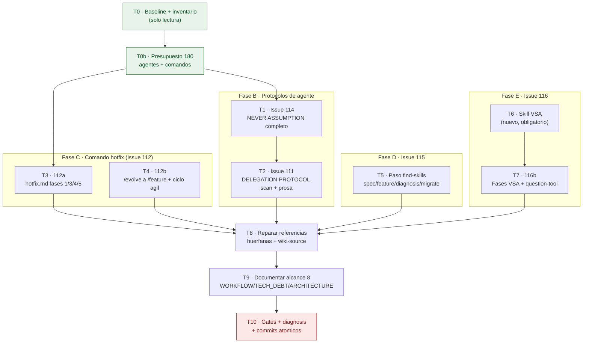

# Implementation Plan: FEV-31 (v2.1.5) — Issues #111–#116 + reparación de referencias + documentación out-of-scope

> **Estado:** PLANIFICADO — no implementado. Este documento es la guía de ejecución; `/build` lo consumirá task por task.
> **Rama:** `hotfix/update-payload` · **Target:** v2.1.5 · **Milestone:** 2.1.x
> **Diagnóstico fuente:** [`docs/diagnosis/fix30-fev31-partial-issue-implementation.md`](../docs/diagnosis/fix30-fev31-partial-issue-implementation.md) (§9 Solución propuesta, 8 pasos)
> **Issues:** [#111](https://github.com/fisherk2/codice-opencode/issues/111) · [#112](https://github.com/fisherk2/codice-opencode/issues/112) · [#113](https://github.com/fisherk2/codice-opencode/issues/113) · [#114](https://github.com/fisherk2/codice-opencode/issues/114) · [#115](https://github.com/fisherk2/codice-opencode/issues/115) · [#116](https://github.com/fisherk2/codice-opencode/issues/116)

---

## 1. Overview

La rama `hotfix/update-payload` mezcla una **implementación parcial de FEV-31** con una **reestructuración del workspace fuera de alcance**. El commit de estabilización `1941ed3` puso los gates en verde pero **no cerró ningún gap de issue** ni reparó las referencias huérfanas (§4.1 del diagnóstico).

Este plan ejecuta los **8 pasos de §9 del diagnóstico** completos, más el realineamiento del presupuesto de líneas decidido en la revisión del plan, reorganizados en 11 tareas con slices verticales: cada tarea deja un resultado verificable por sí mismo, sin capas horizontales (nada de "primero todos los agentes, luego todos los comandos").

**Resultado esperado:**

1. Los 6 issues de FEV-31 quedan **cerrados** (#113 ya lo estaba; #111/#114 cierran sus gaps menores; #112/#115/#116 se completan).
2. Cero referencias huérfanas en el árbol **trackeado** (excluyendo `docs/diagnosis/*` — histórico inmutable, decisión del usuario).
3. Los cambios fuera de alcance (§8 del diagnóstico) quedan **registrados** en `docs/WORKFLOW.md`, `docs/TECH_DEBT.md`, `docs/ARCHITECTURE.md` y en la wiki.
4. Gates verdes: `just test` 1972+/0, `just coverage-check`, `just test-e2e` 31/31, `tsc --noEmit` 0.

---

## 2. Baseline verificado (2026-11-17, rama `hotfix/update-payload` @ `1619a87`)

| Gate | Estado | Comando |
|------|--------|---------|
| Tests unit + integration | ✅ **1972 pass / 0 fail** (72 files, 19.65s) | `just test` |
| E2E | ✅ **31 passed / 0 failed** | `just test-e2e` |
| Typecheck | ✅ **exit 0** | `bun run tsc --noEmit` |
| Biome (`just check`) | ⚠️ **NO DISPONIBLE** — binario no ejecutable en montaje fuseblk/NTFS (TD-V2-97) | `bunx @biomejs/biome ci src/ tests/` → `error: ... is not executable` (exit 126) |
| Biome (workaround) | ✅ **exit 0** — 147 archivos, 2 warnings + 1 info preexistentes | `install -m 755 node_modules/@biomejs/cli-linux-x64/biome /tmp/opencode/biome` + `/tmp/opencode/biome ci src/ tests/` |
| Working tree | ~200 archivos sin commitear vs `develop` | `git status --short \| wc -l` → 200 |

**Consecuencia operativa:** `just check` no puede ejecutarse en este mount, pero el lint **sí** se valida localmente con la copia ejecutable en `/tmp/opencode/biome` (`/tmp` es btrfs y conserva el bit `+x`). Cada task que toque `src/` o `tests/` debe pasar `bun run tsc --noEmit` + `/tmp/opencode/biome ci src/ tests/` localmente, y `just check` se declara como revalidado en CI.

### 2.1 Inventario de referencias stale (verificado con `git ls-files | xargs grep`)

| # | Ubicación | Qué referencia | Tipo |
|---|-----------|----------------|------|
| 1 | `template/obligatorio/packs/writers/obsidian-vault-writer.md:92-102` | 6 skills eliminadas (`obsidian-vault`, `obsidian-markdown`, `obsidian-cli`, `baoyu-format-markdown`, `baoyu-url-to-markdown`, `baoyu-markdown-to-html`) | Referencia colgante |
| 2 | `docs/ARCHITECTURE.md:12-37` | 23 enlaces `../specs/adr/` (los ADRs se movieron a `docs/adr/`) | Enlace muerto |
| 3 | `AGENTS.md:67` | `[adr/](specs/adr/)` | Enlace muerto |
| 4 | `SPEC.md:38` | `see [specs/adr/](specs/adr/)` | Enlace muerto |
| 5 | `docs/MIGRATION.md:253-254` | `[ADR-014](../specs/adr/…)`, `[ADR-015](../specs/adr/…)` | Enlace muerto |
| 6 | `template/estandar/SPEC.md`, `template/estandar/docs/ARCHITECTURE.md` | `specs/adr/` | Enlace muerto (template) |
| 7 | `specs/spec-agent-packs.md:37` | `skills-lock.json` (eliminado) | Mención stale |
| 8 | `specs/spec-file-rules.md:35,45` | `skills-lock.json` y `requirements.txt` (eliminados) | Mención stale |
| 9 | `docs/wiki-source/Skills.md` | `obsidian-*`, `xlsx`, `excel-analysis` | Mención stale |
| 10 | `docs/wiki-source/Commands.md`, `Agents.md`, `Workspace-Structure.md` | `/evolve` (renombrado a `/feature`) | Ref stale |
| 11 | `README.md:33,275,349` | `/evolve`, "17 Slash Commands", "51 Engineering Skills" | Ref stale + contadores |
| 12 | `template/obligatorio/core/commands/docs-update.md:87` | `/evolve` | Ref stale |
| 13 | `template/obligatorio/packs/main/quetzalcoatl.md:199` | `Invoke via: … /evolve` | Ref stale |
| 14 | `tests/fixtures/workspace/` | árbol instalado viejo (`/evolve`, `skills-lock.json`, `requirements.txt`) | Generado (gitignored) |

**Contadores reales del template (verificados):** 60 skills en `template/obligatorio/core/skills/` (README dice 51) · 18 comandos en `template/obligatorio/core/commands/` (README dice 17) · 10 packs.

---

## 3. Decisiones de arquitectura

| # | Decisión | Racional |
|---|----------|-----------|
| **D1** | Planificación en **11 tareas verticales** (T0, T0b, T1…T10), no en las 8 líneas de §9 | §9 agrupa tareas de tamaño distinto (una línea = 1 archivo; otra = 20 archivos). Cada tarea necesita criterios de aceptación verificables |
| **D2** | El skill `vertical-slice-architecture` va a **`template/obligatorio/core/skills/`** | Confirmado por el usuario. 5 comandos lo referencian; en `opcional/` quedaría una ref colgante en toda instalación sin ese pack |
| **D3** | No se toca `docs/diagnosis/*` | Confirmado por el usuario: histórico inmutable (fix28/fix29/fix30). Solo se **actualiza** `fix30` con el resultado de la ejecución |
| **D4** | Cambios out-of-scope documentados en **WORKFLOW + TECH_DEBT + ARCHITECTURE + wiki** | Confirmado por el usuario. `1941ed3` queda registrado como **estabilización INCOMPLETA** en los tres documentos formales |
| **D5** | Trailer `Co-Authored-By: Moctezuma <dev@fisherk2.com>` | Confirmado por el usuario. El trailer nombra al agente de la sesión (esta sesión = Moctezuma) |
| **D6** | T1 y T2 son **secuenciales**, no paralelos | Ambos escriben los mismos 6 archivos de `packs/main/` → conflicto de escritura garantizado si corren en paralelo |
| **D7** | T6 **precede** a T7 | Los 5 comandos referencian el skill VSA; crearlo antes evita refs colgantes en ningún estado intermedio |
| **D8** | T8 (refs) **precede** a T9 (docs out-of-scope) | T9 documenta el árbol final; documentar antes de reparar registraría un estado que no existió |
| **D9** | El nuevo skill VSA **no** usa links cross-skill `../<skill>/references/*.md` | `tests/unit/skill-paths.test.ts:74` afirma `total === 13`; cualquier link cross-skill nuevo rompe el test. Si el subagent lo necesita, debe bumpear el contador **en el mismo commit** con un comentario.delta |
| **D10** | Presupuesto de cuerpo = **180 líneas** para **agentes y comandos**, midiendo **solo el body** (sin YAML frontmatter) | Decisión del usuario 2026-11-17. Sustituye los **100** de `specs/spec-agent-format-v2.md:325` y los **120** de `agent-frontmatter-validation.test.ts:249,254`. Headroom real: agentes 77 (103→180), comandos 71 (109→180). Cubre holgadamente los ~30 líneas que #111/#114/#115/#116 añaden |
| **D11** | Los 3 manifiestos opcionales nuevos (`Cargo.toml`, `package.json`, `pyproject.toml`) **no** requieren entrada de manifiesto adicional | `1941ed3` ya los añadió a `FileRuleManifestData.ts`; verificado |
| **D12** | `tests/fixtures/workspace/` se regenera como **verificación**, no como cambio trackeado | Está en `.gitignore` (solo `.gitkeep` trackeado). Es artefacto de `just dev` |
| **D13** | La regla de comandos no existe hoy: se crea en `tests/unit/domain/command-frontmatter-validation.test.ts` + una nota normativa junto a la regla de 200 líneas de `docs/CODE_STYLE.md:23` | No hay spec de formato de comandos en `specs/` (buscado: 0 resultados). El test es la única fuente normativa vigente para `Suggested Next Step`; el límite se documenta donde ya vive la regla de longitud de archivo |

---

## 4. Grafo de dependencias

**Paralelismo real:** T0b → {T1, T3} obligatorio (el presupuesto de 180 debe estar vigente antes de que se escriban prompts) · T3 ∥ T4 (archivos disjuntos) · T1 → T2 obligatorio (mismos 6 archivos) · T6 → T7 obligatorio (dependencia de contenido) · T8 → T9 → T10 obligatorio (estado del árbol).

---

## 5. Plan de tareas

> **Regla transversal (T0b):** toda task que escriba en `template/obligatorio/packs/main/` o en `template/obligatorio/core/commands/` (T1, T2, T3, T4, T5, T7) debe mantener el **body ≤ 180 líneas**, sin contar el YAML frontmatter. El guard correspondiente se activa en T0b y se verifica en cada checkpoint.

---

### T0 — Congelar baseline e inventario de referencias stale

**Descripción:** Gate de solo lectura que fija el punto de partida verificable y materializa el inventario de referencias stale (Anexo §2.1) en el checklist, para que cada task posterior pueda declarar "closes inventory row N".

**Acceptance criteria:**
- [ ] `just test` → ≥1972 pass / 0 fail (baseline registrado)
- [ ] `just test-e2e` → 31/31
- [ ] `bun run tsc --noEmit` → exit 0
- [ ] `bunx @biomejs/biome ci src/ tests/` → fallo documentado como **limitación de entorno NTFS**, no de código
- [ ] Inventario §2.1 copiado a `tasks/todo.md` como checklist con 14 filas

**Verification:**
- [ ] `git status --short | wc -l` → 200 (sin cambios netos)
- [ ] `git log --oneline -1` → `1619a87`

**Dependencies:** None · **Files touched:** `tasks/todo.md` (solo) · **Scope:** XS

**Asignación:**

| Subagent | Skills | Tools / MCPs | Recursos externos |
|---|---|---|---|
| `codebase-archaeologist` | `codebase-onboarding`, `codebase-design` | `codebase-memory-mcp`, `vercel-grep` | diagnóstico fix30 §2.1 |

---

### T0b — Alinear el presupuesto de líneas a 180 (agentes + comandos)

**Descripción:** Decisión del usuario (2026-11-17): el límite de cuerpo para system prompts pasa a **180 líneas** y aplica por igual a los 6 agentes primarios y a los 18 comandos del template, midiendo **solo el body** (sin YAML frontmatter). Hoy la fuente normativa dice 100 (`specs/spec-agent-format-v2.md:325`) y el test aplica 120 (`agent-frontmatter-validation.test.ts:249,254`, con un comentario stale "≤100" en la 243), mientras que **los comandos no tienen límite alguno**. Este task alinea spec + tests **antes** de que T1–T7 engrosen los prompts; de lo contrario el guard viejo fallaría a mitad de FEV-31.

**Acceptance criteria:**
- [ ] `specs/spec-agent-format-v2.md` §8 *Line budget*: 100 → **180**, con nota explícita de que se mide el body (sin frontmatter)
- [ ] `tests/unit/domain/agent-frontmatter-validation.test.ts:249,254`: nombre del test y `toBeLessThanOrEqual` → **180**; comentario de la línea 243 corregido (100 → 180); comentario FEV-31 de la 247 ajustado al nuevo margen
- [ ] `tests/unit/domain/command-frontmatter-validation.test.ts`: **nuevo** describe "Body line budget" que mide el body tras `extractFrontmatter` y afirma `toBeLessThanOrEqual(180)` para los 18 comandos (mismo patrón que el test de agentes — DRY, sin helper nuevo)
- [ ] `docs/CODE_STYLE.md:23`: nota normativa junto a la regla de 200 líneas — "Template Markdown prompts (agentes y comandos): body ≤180 líneas, excluyendo YAML frontmatter"
- [ ] Ningún otro archivo introduce un número de límite distinto (buscar `100 lines`, `120 lines`, `toBeLessThanOrEqual(120)` en `tests/`, `specs/`, `docs/` → 0 matches fuera de `docs/diagnosis/` e históricos)

**Verification:**
- [ ] `just test` → 0 fail (los 6 agentes max 103, los 18 comandos max 109 → ambos por debajo de 180)
- [ ] `bun run tsc --noEmit` → exit 0
- [ ] `grep -rn "toBeLessThanOrEqual(180)" tests/unit/domain/{agent,command}-frontmatter-validation.test.ts` → 2 matches
- [ ] `just check` → pendiente de CI (NTFS)

**Dependencies:** T0, T0b · **Files touched:** `specs/spec-agent-format-v2.md`, `tests/unit/domain/agent-frontmatter-validation.test.ts`, `tests/unit/domain/command-frontmatter-validation.test.ts`, `docs/CODE_STYLE.md` · **Scope:** S (4 archivos)

**Asignación:**

| Subagent | Skills | Tools / MCPs | Recursos externos |
|---|---|---|---|
| `test-engineer` | `test-driven-development`, `clean-code`, `documentation-and-adrs` | shell (`just test`, `bun run tsc --noEmit`) | `specs/spec-agent-format-v2.md` §8, `docs/CODE_STYLE.md`, decisión del usuario 2026-11-17 |

> **Nota:** este task no estaba en §9 del diagnóstico — es una decisión nueva del usuario tomada durante la revisión del plan. Se añade aquí para que FEV-31 ejecute el cambio con el resto y no quede un guard viejo contradiciendo al nuevo.

---

### T1 — #114: cerrar NEVER ASSUMPTION PROTOCOL (6 agentes primarios)

**Descripción:** Añadir en los 6 agentes de `template/obligatorio/packs/main/` la viñeta de **prohibición de ejecución en background** (sintetizada a 1 línea, según el "Alternatives Considered" del issue) y corregir el ítem 4 de la fuente de verdad para citar `web-search`/`web-fetch`. El protocolo ya existe en los 6 (líneas 139/108/123/156/110/107); faltan exactamente 2 elementos.

**Acceptance criteria:**
- [ ] Los 6 agentes contienen una viñeta de rules que prohíbe `&`, `nohup`, `disown`, `setsid` y procesos huérfanos (prohibición de ejecución en background), en una sola línea
- [ ] El ítem 4 de "Source of truth" cita `web-search`/`web-fetch` (no solo `web-search`)
- [ ] El texto en inglés está gramaticalmente correcto (el issue #111 señala prosa rota)
- [ ] Cuerpo de cada agente ≤ **180 líneas** (`agent-frontmatter-validation.test.ts`, alineado en T0b)
- [ ] Frontmatter `permissions:` intacto — no reintroducir `tools:` ni `permission:` (guards legacy)

**Verification:**
- [ ] `just test` → 0 fail (incluye `tests/unit/domain/agent-frontmatter-validation.test.ts`)
- [ ] `grep -rn "nohup\|disown\|setsid" template/obligatorio/packs/main/` → 6 archivos
- [ ] `grep -rn "web-fetch" template/obligatorio/packs/main/` → 6 archivos
- [ ] `bun run tsc --noEmit` → exit 0

**Dependencies:** T0, T0b · **Files touched:** `template/obligatorio/packs/main/{huitzilopochtli,mictlantecuhtli,moctezuma,quetzalcoatl,tezcatlipoca,tlaloc}.md` · **Scope:** M (6 archivos)

**Asignación:**

| Subagent | Skills | Tools / MCPs | Recursos externos |
|---|---|---|---|
| `technical-writer` (secuencial; T2 usa `prompt-engineer`) | `clean-code`, `documentation-and-adrs` | `vercel-grep` | issue #114, https://opencode.ai/v2/docs/agents |

---

### T2 — #111: completar DELEGATION PROTOCOL (5 agentes delegantes + `/plan`)

**Descripción:** El protocolo de shell ya está presente en los 5 agentes delegantes (huitzilopochtli:110-118, mictlantecuhtli:79-87, quetzalcoatl:127-135, tezcatlipoca:81-89, tlaloc:78-86) y `plan.md:28`. Faltan los gaps menores: (a) el comando de scan debe cubrir `agents/` **y** `.opencode/agents/`; (b) la prosa del fallback está en inglés roto ("If you can't execute previous command, alternatively, execute `ls agents/*.md` alternatives…"). `moctezuma.md` queda **excluido** (no delega).

**Acceptance criteria:**
- [ ] El bloque bash de los 5 agentes escanea **ambos** directorios (`agents/` y `.opencode/agents/`) con una sola invocación y salida `nombre :: descripción` por subagente
- [ ] La instrucción de fallback está en español claro y **prohíbe explícitamente la herramienta Glob** para listar subagentes (es la causa raíz del bug: `.gitignore` → Glob vacío)
- [ ] El comando `/plan` (`template/obligatorio/core/commands/plan.md`) expone la variante `!`-shell ya verificada y lista los subagentes disponibles
- [ ] Cuerpos de los 5 agentes ≤ **180 líneas** (alineado en T0b)
- [ ] `moctezuma.md` **no** recibe DELEGATION PROTOCOL (exclusión explícita del issue)

**Verification:**
- [ ] `just test` → 0 fail
- [ ] `grep -rn "\.opencode/agents" template/obligatorio/packs/main/` → 5 archivos
- [ ] `grep -c "DELEGATION PROTOCOL" template/obligatorio/packs/main/moctezuma.md` → 0
- [ ] `bun run tsc --noEmit` → exit 0

**Dependencies:** T0, T0b, **T1 (secuencial — mismos 6 archivos)** · **Files touched:** los 5 agentes delegantes + `template/obligatorio/core/commands/plan.md` · **Scope:** M

**Asignación:**

| Subagent | Skills | Tools / MCPs | Recursos externos |
|---|---|---|---|
| `prompt-engineer` | `clean-code`, `documentation-and-adrs` | shell (`ls agents/`, `sed`), `vercel-grep` | issue #111, https://opencode.ai/v2/docs/commands/#shell |

---

### T3 — #112a: completar las fases 1/3/4/5 de `/hotfix`

**Descripción:** `template/obligatorio/core/commands/hotfix.md` tiene el esqueleto de 6 fases y una cadena de escalado a `debugger`/`error-detective` (línea 51), pero las fases 1, 3, 4 y 5 están **vacías**. Rellenarlas reutilizando las estructuras de `plan.md`, `diagnosis.md`, `build.md`, `test.md`, `review.md` y `ship.md` ya presentes en el template. La description del frontmatter ya fue corregida en `1941ed3`.

**Acceptance criteria:**
- [ ] Fase 1 (Identify the Problem) → produce `docs/diagnosis/<slug>.md` siguiendo `docs/diagnosis/diagnosis-template.md`, con la regla "si ya hay un fix en progreso, actualizar ese"
- [ ] Fase 2 (ya existe) → produce `tasks/plan.md` + `tasks/todo.md` con criterios de aceptación (patrón `plan.md`)
- [ ] Fase 3 (Execute) → TDD explícito: tests primero, "ningún gap de pruebas queda fuera"
- [ ] Fase 4 (Test & review) → corre `just test` + revisión de código, corrige observaciones
- [ ] Fase 5 (Validate) → determina **GO / not-GO** para despliegue **sin desplegar** (el issue lo pide explícitamente)
- [ ] Fase 6 (existente) → cierra ticket + actualiza documentación del proyecto
- [ ] Frontmatter válido: `description` no vacío + `agent: tlaloc` (guard de `command-frontmatter-validation.test.ts`)

**Verification:**
- [ ] `just test` → 0 fail
- [ ] `grep -c "^## Phase" template/obligatorio/core/commands/hotfix.md` → 6
- [ ] Ninguna fase del archivo con menos de 3 líneas de cuerpo
- [ ] `bun run tsc --noEmit` → exit 0

**Dependencies:** T0, T0b · **Files touched:** `template/obligatorio/core/commands/hotfix.md` · **Scope:** S (1 archivo)

**Asignación:**

| Subagent | Skills | Tools / MCPs | Recursos externos |
|---|---|---|---|
| `workflow-architect` | `incremental-implementation`, `documentation-and-adrs`, `planning-and-task-breakdown`, `test-driven-development` | `codebase-memory-mcp` | issue #112, https://opencode.ai/v2/docs/commands/, comandos `plan.md`/`diagnosis.md`/`build.md`/`test.md`/`review.md`/`ship.md` del template |

---

### T4 — #112b: renombrar `/evolve` → `/feature` y documentar el ciclo ágil

**Descripción:** El issue pide renombrar `/evolve` a `/feature` (ya renombrado en el árbol de trabajo: `template/obligatorio/core/commands/feature.md` existe, `evolve.md` borrado) y documentar el ciclo `/docs-update` → `/hotfix` → `/deploy` en README y wiki. Quedan 8 referencias stale a `/evolve` y 2 contadores desactualizados en archivos trackeados.

**Acceptance criteria:**
- [ ] Cero ocurrencias de `/evolve` en archivos trackeados (excepto `CHANGELOG.md` — historia — y `docs/diagnosis/*` — histórico)
- [ ] `README.md`: lista de comandos actualizada (`/feature` sustituye a `/evolve`, `/hotfix` añadido) y contador **"17 Slash Commands" → "18 Slash Commands"**
- [ ] `README.md`: contador **"51 Engineering Skills" → "60 Engineering Skills"** (verificado: 60 dirs en `template/obligatorio/core/skills/`)
- [ ] `README.md`: diagrama Mermaid "Evolutionary Flow" actualizado con `/feature` y el ciclo `/docs-update` → `/hotfix` → `/deploy`
- [ ] `README.md`: fila de la tabla de comandos "Evolve project" → "Feature project" con `/feature`
- [ ] `template/obligatorio/core/commands/docs-update.md:87`: "Run `/feature` to create new specs"
- [ ] `template/obligatorio/packs/main/quetzalcoatl.md:199`: `Invoke via: Commands /spec, /design, /feature, /docs-update, /migrate`
- [ ] `docs/wiki-source/{Agents,Commands,Workspace-Structure}.md`: `/evolve` → `/feature` + ciclo ágil + contador de comandos

**Verification:**
- [ ] `git ls-files -z | xargs -0 grep -n "/evolve" | grep -v CHANGELOG.md | grep -v docs/diagnosis/` → **0 matches**
- [ ] `grep -c "18 Slash Commands\|60 Engineering Skills" README.md` → 2
- [ ] `just test` → 0 fail (el README no está en gates, pero el wiki-source sí lo está vía `source-hygiene`)

**Dependencies:** T0, T0b · **Files touched:** `README.md`, `template/obligatorio/core/commands/docs-update.md`, `template/obligatorio/packs/main/quetzalcoatl.md`, `docs/wiki-source/{Agents,Commands,Workspace-Structure}.md` · **Scope:** M (7 archivos)

**Asignación:**

| Subagent | Skills | Tools / MCPs | Recursos externos |
|---|---|---|---|
| `docs-writer` | `crafting-effective-readmes`, `documentation-and-adrs`, `markdown-mermaid-writing` | `vercel-grep` | issue #112, https://opencode.ai/v2/docs/commands/ |

> **Paralelismo:** T3 ∥ T4 — archivos disjuntos. Ambos pueden correr en paralelo.

---

### T5 — #115: paso de instalación de skills con `find-skills`

**Descripción:** Añadir un paso de setup de skills en los 4 comandos del issue — `/spec`, `/feature`, `/diagnosis`, `/migrate` — después de establecer la intención del usuario. Flujo: buscar con la skill `find-skills` según el propósito/stack → mostrar tabla de skills candidatas → `question` tool (todas / solo las más importantes / ninguna) → instalar **a nivel de proyecto, NUNCA global** → fallback documentado si `find-skills` no está instalada.

**Acceptance criteria:**
- [ ] Los 4 comandos tienen un paso explícito de "setup/instalación de skills" (fase propia, no una viñeta suelta) situado tras la fase de intención/análisis
- [ ] El paso invoca la skill `find-skills` (o el fallback `npx skills use "https://github.com/vercel-labs/skills" --skill "find-skills"`) y **documenta el fallback** cuando no está instalada
- [ ] El paso presenta una **tabla** de skills candidatas antes de instalar
- [ ] El paso usa el `question` tool con 3 opciones: todas / solo las más importantes / ninguna
- [ ] El paso declara explícitamente **instalación a nivel de proyecto, NUNCA global**
- [ ] La nota "NEVER global" aparece textual en los 4 comandos
- [ ] Ninguna referencia a `find-skills` queda sin resolver (el nombre de skill es literal y consistente en los 4)

**Verification:**
- [ ] `grep -rn "find-skills" template/obligatorio/core/commands/{spec,feature,diagnosis,migrate}.md` → 4 archivos, ≥1 hit cada uno
- [ ] `grep -rln "nunca global\|NUNCA global\|never global" template/obligatorio/core/commands/` → 4 archivos
- [ ] `just test` → 0 fail
- [ ] `bun run tsc --noEmit` → exit 0

**Dependencies:** T0, T0b · **Files touched:** `template/obligatorio/core/commands/{spec,feature,diagnosis,migrate}.md` · **Scope:** M (4 archivos)

**Asignación:**

| Subagent | Skills | Tools / MCPs | Recursos externos |
|---|---|---|---|
| `technical-writer` | `find-skills`, `documentation-and-adrs`, `spec-driven-development` | `vercel-grep` (búsqueda en skills.sh), web search | issue #115, https://www.skills.sh/vercel-labs/skills/find-skills, https://github.com/vercel-labs/skills |

---

### T6 — #116a: crear el skill `vertical-slice-architecture` (obligatorio)

**Descripción:** El skill referenciado por 5 comandos **no existe**. Crearlo como skill universal (no atada a .NET ni a un dominio) que explique VSA, las metodologías de desarrollo tradicionales vs ágiles, y cómo decidir cuál aplicar al diseñar fases. `SKILL.md` corto + `references/` con una referencia por metodología, tal como pide el issue.

**Acceptance criteria:**
- [ ] `template/obligatorio/core/skills/vertical-slice-architecture/SKILL.md` existe con frontmatter YAML válido (`name`, `description`) y descripción en third-person que dispare correctamente
- [ ] `SKILL.md` contiene: qué es VSA, cómo decidir metodología (tradicional vs ágil), el criterio de conteo de fases (Prototipado 1-3 / MVP 4-6 / Empresarial 7+), qué **no** hacer (anti-patrones cascada), y el algoritmo de corte vertical
- [ ] `references/` contiene al menos: waterfall/cascada, agile (Scrum/Kanban), VSA/vertical-slice, y una guía comparativa de decisión — una metodología por archivo
- [ ] Las referencias internas del skill usan paths que **existen** (guard de `skill-paths.test.ts`)
- [ ] El skill **no** introduce links cross-skill `../<skill>/references/*.md`; si el subagent los necesita, bumpea el contador de `tests/unit/skill-paths.test.ts:74` de 13 → N **en el mismo commit** con comentario.delta
- [ ] `SKILL.md` breve por diseño (el detalle va a `references/`); el presupuesto **enforced** de 180 líneas aplica a agentes y comandos, no a skills
- [ ] No hay bytes de control crudos (guard `source-hygiene.test.ts` — pero ese escanea `template/obligatorio/packs`, no `core/skills`; se mantiene por higiene)

**Verification:**
- [ ] `ls template/obligatorio/core/skills/vertical-slice-architecture/` → `SKILL.md` + `references/`
- [ ] `ls template/obligatorio/core/skills/vertical-slice-architecture/references/ | wc -l` → ≥4
- [ ] `just test` → 0 fail (**incluye `tests/unit/skill-paths.test.ts`** — el contador cross-skill debe seguir en 13 salvo bump justificado)
- [ ] `bun run tsc --noEmit` → exit 0

**Dependencies:** T0, T0b · **Files touched:** `template/obligatorio/core/skills/vertical-slice-architecture/**` (nuevo) · **Scope:** M (nuevo, ~6 archivos)

**Asignación:**

| Subagent | Skills | Tools / MCPs | Recursos externos |
|---|---|---|---|
| `software-architect` | `skill-creator` (el issue lo pide explícitamente), `opencode-skill-creator`, `clean-ddd-hexagonal`, `documentation-and-adrs` | plugin `opencode-skill-creator` (tools `skill_*`), web search | issue #116, https://www.skills.sh/mryll/skills/vertical-slice-architecture, https://www.skills.sh/codewithmukesh/dotnet-claude-kit/vertical-slice, https://www.skills.sh/donchitos/claude-code-game-studios/vertical-slice, https://es.wikipedia.org/wiki/Metodolog%C3%ADa_de_desarrollo_de_software, https://nadirbad.dev/vertical-slice-architecture-dotnet, https://opencode.ai/docs/skills/ |

---

### T7 — #116b: fases VSA con question-tool en los 5 comandos

**Descripción:** Reemplazar los placeholders `[Aqui se delega a software-architect …]` por fases VSA reales: pregunta de alcance con el `question` tool (Prototipado / MVP / Empresarial → 1-3 / 4-6 / 7+ fases), delegación a `software-architect` con la skill VSA cargada, y escritura del roadmap en `docs/WORKFLOW.md`.

**Acceptance criteria:**
- [ ] Los 5 comandos (`spec`, `feature`, `diagnosis`, `migrate`, `hotfix`) tienen una **fase VSA** con contenido real (no un placeholder entre corchetes)
- [ ] La fase usa el `question` tool con las 3 opciones de alcance y sus rangos de fases (1-3 / 4-6 / 7+) textuales
- [ ] La fase delega a `software-architect` **cargando explícitamente** el skill `vertical-slice-architecture` (más `clean-ddd-hexagonal` y `codebase-design` donde ya se pedían)
- [ ] La fase indica **dónde** se escribe el resultado: `docs/WORKFLOW.md` (roadmap de fases de implementación)
- [ ] La fase respeta la diferencia de cada comando: `/spec` → *establece* el roadmap; `/feature` y `/diagnosis` → *actualizan* el roadmap; `/migrate` → *actualizan*; `/hotfix` → *estructura según VSA* (fase 2, ya existente)
- [ ] Cero placeholders `[Aqui se delega …]` restantes en `template/obligatorio/core/commands/`

**Verification:**
- [ ] `grep -rn "\[Aqui se delega" template/obligatorio/core/commands/` → **0 matches**
- [ ] `grep -rln "vertical-slice-architecture" template/obligatorio/core/commands/` → 5 archivos
- [ ] `grep -rln "Prototipado\|MVP\|Empresarial" template/obligatorio/core/commands/` → 5 archivos
- [ ] `just test` → 0 fail
- [ ] `bun run tsc --noEmit` → exit 0

**Dependencies:** **T6** (el skill debe existir antes de referenciarlo) · **Files touched:** `template/obligatorio/core/commands/{spec,feature,diagnosis,migrate,hotfix}.md` · **Scope:** M (5 archivos)

**Asignación:**

| Subagent | Skills | Tools / MCPs | Recursos externos |
|---|---|---|---|
| `workflow-architect` | `clean-ddd-hexagonal`, `codebase-design`, `documentation-and-adrs` | `codebase-memory-mcp` | issue #116, el skill `vertical-slice-architecture` creado en T6 |

---

### T8 — Reparar referencias huérfanas y sincronizar la wiki

**Descripción:** Cerrar las 14 filas del inventario §2.1 que no son de #112 (filas 1–9, 14). Incluye las 6 skills borradas que `obsidian-vault-writer.md` sigue ordenando cargar, los 27 enlaces ADR muertos tras el traslado `specs/adr/` → `docs/adr/`, las menciones a `skills-lock.json`/`requirements.txt`, el `wiki-source` con skills inexistentes, y la regeneración del fixture de dev.

**Acceptance criteria:**
- [ ] `template/obligatorio/packs/writers/obsidian-vault-writer.md`: la sección "Skills" ya **no** ordena cargar ninguna skill eliminada; los sustitutos son skills **existentes** del template, o se documenta que las skills de Obsidian se instalan bajo demanda vía `find-skills` (enlaza con T5)
- [ ] `docs/ARCHITECTURE.md`: los 23 enlaces apuntan a `docs/adr/adr-0NN-*.md` (mismo nombre de archivo, solo cambia el prefijo) — **0** enlaces `../specs/adr/`
- [ ] `AGENTS.md`, `SPEC.md`, `docs/MIGRATION.md`: enlaces ADR corregidos a `docs/adr/`
- [ ] `template/estandar/SPEC.md` y `template/estandar/docs/ARCHITECTURE.md`: enlaces ADR corregidos (el template ahora usa `docs/adr/`, no `specs/adr/`)
- [ ] `specs/spec-agent-packs.md:37` y `specs/spec-file-rules.md:35,45`: sin menciones a `skills-lock.json` ni `requirements.txt` (o con la categoría correcta si el archivo sigue existiendo en el árbol final)
- [ ] `docs/wiki-source/Skills.md`: sin `obsidian-*`, `xlsx`, `excel-analysis`; refleja las 60 skills reales
- [ ] `tests/fixtures/workspace/` regenerado y **sin** `/evolve`, `skills-lock.json` ni `requirements.txt` (artefacto gitignored — verificación, no commit)
- [ ] `docs/diagnosis/*` **intacto** (decisión D3)

**Verification:**
- [ ] `git ls-files -z | xargs -0 grep -n "specs/adr/" | grep -v CHANGELOG.md | grep -v docs/diagnosis/ | grep -v tasks/` → **0 matches**
- [ ] `git ls-files -z | xargs -0 grep -ln "skills-lock.json" | grep -v ".gitignore" | grep -v docs/diagnosis/` → **0 matches** (o solo `tests/integration/adapters/bun-file-system.test.ts` si el test lo usa como fixture — en cuyo caso se documenta)
- [ ] `grep -rn "obsidian-vault\|baoyu-format-markdown" template/obligatorio/packs/writers/obsidian-vault-writer.md` → **0 matches**
- [ ] `just test` → 0 fail
- [ ] `just test-e2e` → 31/31
- [ ] `bun run tsc --noEmit` → exit 0

**Dependencies:** T0, T2, T3, T4, T5, T7 (el contenido final debe existir antes de referenciarlo) · **Files touched:** `obsidian-vault-writer.md`, `docs/ARCHITECTURE.md`, `AGENTS.md`, `SPEC.md`, `docs/MIGRATION.md`, `template/estandar/SPEC.md`, `template/estandar/docs/ARCHITECTURE.md`, `specs/spec-agent-packs.md`, `specs/spec-file-rules.md`, `docs/wiki-source/Skills.md` · **Scope:** L (10 archivos) → **dividir en dos commits atómicos: (a) enlaces ADR, (b) skills/stale**

**Asignación:**

| Subagent | Skills | Tools / MCPs | Recursos externos |
|---|---|---|---|
| `codebase-archaeologist` | `codebase-onboarding`, `codebase-design`, `documentation-and-adrs` | `codebase-memory-mcp`, `vercel-grep` | diagnóstico fix30 §4.1, `CONTRIBUTING.md` (procedimiento de wiki sync) |

---

### T9 — Documentar los cambios fuera de alcance (§8 del diagnóstico)

**Descripción:** Registrar formalmente el inventario de §8 —que acompaña al hito pero no pertenece a FEV-31— en la documentación viva del proyecto, y dejar constancia de que `1941ed3` fue una **estabilización INCOMPLETA**. Sin esto, la documentación oficial describe un árbol que ya no existe.

**Acceptance criteria:**
- [ ] `docs/WORKFLOW.md`: fila **FEV-31** en la tabla de fases (issues #111–#116, estado y fecha) + sección que registre el snapshot de trabajo (ADR move, skills +17/-8, `skills-lock.json` eliminado, `.gitmessage`/`requirements.txt` eliminados, manifiestos opcionales nuevos, reescritura de estilo de 13 comandos, swap de 6 modelos)
- [ ] `docs/TECH_DEBT.md`: entrada de debt registrada con estado (qué se resolvió en FEV-31, qué queda abierto) + la limitación de `just check` en NTFS ya existente
- [ ] `docs/ARCHITECTURE.md`: nota del **traslado de ADRs** `specs/adr/` → `docs/adr/` (23 archivos) y de que `specs/adr/` ya no existe
- [ ] `docs/ARCHITECTURE.md`: nota de que `1941ed3` fue estabilización INCOMPLETA (referencia al diagnóstico fix30)
- [ ] `docs/wiki-source/`: reflejan el estado real (comandos 18, skills 60, ADRs en `docs/adr/`, ciclo `/docs-update` → `/hotfix` → `/deploy`)
- [ ] La documentación **no** afirma que #113/los swaps de modelos formen parte de FEV-31 — se marcan como adyacentes fuera de alcance
- [ ] `docs/diagnosis/fix30-fev31-partial-issue-implementation.md`: §2 actualizada con el estado final por issue + nota "resuelto en FEV-31" (el resto del archivo se conserva)
- [ ] `CHANGELOG.md`: entrada `[2.1.5]` si la rama ya se prepara para release (si no, la task lo deja para el release flow)

**Verification:**
- [ ] `grep -n "FEV-31" docs/WORKFLOW.md docs/TECH_DEBT.md` → ambos
- [ ] `grep -n "docs/adr" docs/ARCHITECTURE.md | head` → rutas `docs/adr/`
- [ ] `just test` → 0 fail · `bun run tsc --noEmit` → exit 0
- [ ] Revisión manual: ningún documento afirma que `/evolve` exista

**Dependencies:** T8 · **Files touched:** `docs/WORKFLOW.md`, `docs/TECH_DEBT.md`, `docs/ARCHITECTURE.md`, `docs/wiki-source/*.md`, `docs/diagnosis/fix30-fev31-partial-issue-implementation.md`, (opcional) `CHANGELOG.md` · **Scope:** M (7 archivos)

**Asignación:**

| Subagent | Skills | Tools / MCPs | Recursos externos |
|---|---|---|---|
| `docs-writer` | `documentation-and-adrs`, `crafting-effective-readmes`, `agent-md-refactor` | `gitmcp`, `vercel-grep` | diagnóstico fix30 §8, `CONTRIBUTING.md`, `docs/ARCHITECTURE.md` |

---

### T10 — Gates finales, cierre del diagnóstico y commits atómicos

**Description:** Cerrar la fase ejecutando la escalera de gates completa, revisando el diff completo contra los criterios de aceptación de T0–T9, y cerrando con commits atómicos.

**Acceptance criteria:**
- [ ] `just test` → 0 fail, count ≥ 1972 (no regresión)
- [ ] `just coverage-check` → 0 fail (gate global 95% + sub-gate `src/cli/main.ts` 95%)
- [ ] `just test-e2e` → 31/31
- [ ] `bun run tsc --noEmit` → exit 0
- [ ] `just check` → **no ejecutable en NTFS**; se declara explícitamente en el mensaje de commit y se delega la verificación de biome a CI
- [ ] Todos los criterios de aceptación de T0–T9 marcados como cumplidos en `tasks/todo.md`
- [ ] §4.1 de `docs/diagnosis/fix30-…md` actualizado: `1941ed3` sigue marcado INCOMPLETO **históricamente**, con nota de que FEV-31 lo completa
- [ ] Commits atómicos: **1 commit por concern lógico**, mensajes Conventional Commits, trailer `Co-Authored-By: Moctezuma <dev@fisherk2.com>` en cada uno
- [ ] `git status` sin archivos no intencionados; los ~200 cambios del usuario preservados (no revertidos ni sobrescritos)

**Verification:**
- [ ] `git log --oneline develop..HEAD` — cada commit mapea a 1 task del plan
- [ ] `git diff develop --stat` — ningún archivo fuera del alcance de FEV-31 alterado de forma no documentada
- [ ] `git show --stat HEAD` — trailer presente

**Dependencies:** T9 · **Files touched:** `tasks/todo.md`, `docs/diagnosis/fix30-fev31-partial-issue-implementation.md` (+ los archivos de cada task) · **Scope:** S (cierre)

**Asignación:**

| Subagent | Skills | Tools / MCPs | Recursos externos |
|---|---|---|---|
| `test-engineer` | `git-workflow-and-versioning`, `code-review-and-quality`, `test-driven-development` | shell (`just test`, `just coverage-check`, `just test-e2e`) | `CONTRIBUTING.md` (escalera de gates), `docs/diagnosis/diagnosis-template.md` |

---

## 6. Checkpoints entre fases

### Checkpoint A — Baseline y presupuesto (tras T0 → T0b)
- [ ] `just test` ≥1972/0 · `just test-e2e` 31/31 · `tsc --noEmit` 0
- [ ] Inventario de 14 referencias stale materializado en `tasks/todo.md`
- [ ] `git status --short | wc -l` == 200 al cerrar T0 (nada tocado aún)
- [ ] Spec 100 → 180 · test de agentes 120 → 180 · **test de comandos creado** con 180 · nota en `CODE_STYLE.md`
- [ ] `grep -rn "toBeLessThanOrEqual(180)" tests/unit/domain/{agent,command}-frontmatter-validation.test.ts` → 2 matches

### Checkpoint B — Protocolos de agente (tras T1 → T2)
- [ ] `grep -rn "nohup\|disown\|setsid" template/obligatorio/packs/main/` → 6 archivos
- [ ] `grep -rn "web-fetch" template/obligatorio/packs/main/` → 6 archivos
- [ ] `grep -rn "\.opencode/agents" template/obligatorio/packs/main/` → 5 archivos (no moctezuma)
- [ ] `grep -c "DELEGATION PROTOCOL" template/obligatorio/packs/main/moctezuma.md` → 0
- [ ] `just test` → 0 fail (guard de cuerpo ≤180 líneas — agentes y comandos)
- [ ] Revisión humana de la prosa en inglés de los 6 agentes

### Checkpoint C — Comando /hotfix (tras T3 ∥ T4)
- [ ] `grep -c "^## Phase" template/obligatorio/core/commands/hotfix.md` → 6, ninguna vacía
- [ ] `git ls-files -z | xargs -0 grep -n "/evolve" | grep -v CHANGELOG.md | grep -v docs/diagnosis/` → 0
- [ ] `README.md` dice "18 Slash Commands" y "60 Engineering Skills"
- [ ] `just test` → 0 fail

### Checkpoint D — #115 (tras T5)
- [ ] `find-skills` presente en los 4 comandos, con tabla + question-tool + "nunca global" + fallback `npx skills use`
- [ ] `just test` → 0 fail

### Checkpoint E — #116 (tras T6 → T7)
- [ ] Skill VSA existe en `template/obligatorio/core/skills/` con `references/` (≥4 metodologías)
- [ ] `grep -rn "\[Aqui se delega" template/obligatorio/core/commands/` → 0
- [ ] `tests/unit/skill-paths.test.ts` sigue en verde (contador cross-skill = 13, salvo bump documentado)
- [ ] `just test` → 0 fail

### Checkpoint F — Referencias (tras T8)
- [ ] 0 enlaces `specs/adr/` en archivos trackeados (salvo CHANGELOG/diagnosis/tasks)
- [ ] 0 menciones a skills eliminadas en el template
- [ ] `docs/wiki-source/` coherente con el template
- [ ] `just test` → 0 fail · `just test-e2e` → 31/31

### Checkpoint G — Documentación out-of-scope (tras T9)
- [ ] `FEV-31` presente en WORKFLOW.md y TECH_DEBT.md
- [ ] ADR move documentado en ARCHITECTURE.md
- [ ] `1941ed3` registrado como estabilización INCOMPLETA
- [ ] `just test` → 0 fail

### Checkpoint H — Cierre (tras T10) — **gate de salida de FEV-31**
- [ ] `just test` → 0 fail, count ≥1972
- [ ] `just coverage-check` → 0 fail
- [ ] `just test-e2e` → 31/31
- [ ] `bun run tsc --noEmit` → exit 0
- [ ] `just check` → pendiente de CI (limitación NTFS documentada)
- [ ] Todos los criterios de `tasks/todo.md` marcados
- [ ] Commits atómicos con trailer `Co-Authored-By: Moctezuma <dev@fisherk2.com>`
- [ ] PR hacia `develop` preparado (no mergeado sin GO del usuario)

---

## 7. Riesgos y mitigaciones

| # | Riesgo | Impacto | Mitigación |
|---|--------|---------|------------|
| **R1** | `just check` no ejecutable (biome en fuseblk/NTFS, exit 126 — TD-V2-97) | `just check` no corre localmente | `tsc --noEmit` sí corre; el lint se valida con `/tmp/opencode/biome ci src/ tests/` (exit 0 verificado) y se revalida en CI. Declarado en el commit de T10 y en `docs/TECH_DEBT.md` |
| **R2** | El contador cross-skill de `skill-paths.test.ts:74` (=== 13) se rompe al crear el skill VSA | Test rojo en CI | D9: el skill VSA usa solo refs locales; si hay link cross-skill, bumpear el contador en el mismo commit con comentario.delta |
| **R3** | Con el nuevo límite de 180 el riesgo de cuerpo largo **baja a Medio**: headroom real 77 (agentes, máx. 103) y 71 (comandos, máx. 109); #111/#114/#115/#116 añaden ~30 | Test rojo en T1/T2/T5/T7 solo si se pega prosa sin sintetizar | T0b alinea ambos guards **antes** de escribir; T1/T2 sintetizan la viñeta a 1 línea (buena práctica aunque ya cabe); verificar con `just test` en cada commit |
| **R4** | T1 y T2 en paralelo → conflicto de escritura en los mismos 6 archivos | Pérdida de trabajo | D6: SECUENCIAL obligatorio. T3 ∥ T4 sí es seguro (archivos disjuntos) |
| **R5** | Los comandos quedan referenciando un skill inexistente si T7 corre antes de T6 | Ref colgante en instalaciones | D7: T6 → T7 estrictamente. Verificación: `grep -rln vertical-slice-architecture template/obligatorio/core/skills/` → 1 |
| **R6** | Sobreescribir los ~200 cambios del usuario (no commiteados) | Pérdida de trabajo no recuperable | T0 congela `git status --short | wc -l` == 200 como baseline; T10 verifica que el diff final solo contiene lo planificado + lo preexistente. **Prohibido `git checkout`/`git stash` sobre archivos no commiteados** |
| **R7** | `docs/wiki-source/.wiki/` es un **repo git separado** → el sync no entra en este PR | Wiki desincronizada | T8/T9 editan `docs/wiki-source/*.md` (trackeados aquí) y el push a `.wiki` se hace como paso separado documentado en `CONTRIBUTING.md` |
| **R8** | El diagnóstico fix30 se reescribe y se pierde la línea histórica | Pérdida de trazabilidad | D3: solo se actualizan §2 y §4.1 con estado final; el resto del archivo se conserva literal |
| **R9** | Los swaps de modelo de #113 rompen algún agente (modelo no disponible en otro host) | Agentes que no arrancan | T2 verifica contra el catálogo OpenCode; documentar en T9 que es adyacente fuera de alcance y ya validado |
| **R10** | 60 skills × contenido = el instalador crece y el smoke de E2E puede exceder timeouts | E2E flaky | `just test-e2e` en cada checkpoint; los E2E actuales pasan con el árbol actual → riesgo bajo |

---

## 8. Matriz resumen: subagents · skills · tools · recursos

| Task | Subagent | Skills | Tools / MCPs / Plugins | Recursos externos | Parallel |
|------|----------|--------|-----------------------|-------------------|----------|
| T0 | `codebase-archaeologist` | `codebase-onboarding`, `codebase-design` | `codebase-memory-mcp`, `vercel-grep` | fix30 §2.1 | — |
| T0b | `test-engineer` | `test-driven-development`, `clean-code`, `documentation-and-adrs` | shell (`just test`, `tsc --noEmit`) | spec-agent-format-v2 §8, CODE_STYLE.md, decisión 2026-11-17 | antes de T1/T3 |
| T1 | `technical-writer` | `clean-code`, `documentation-and-adrs` | `vercel-grep` | #114, opencode.ai/v2/docs/agents | secuencial |
| T2 | `prompt-engineer` | `clean-code`, `documentation-and-adrs` | shell, `vercel-grep` | #111, opencode.ai/v2/docs/commands/#shell | secuencial |
| T3 | `workflow-architect` | `incremental-implementation`, `documentation-and-adrs`, `planning-and-task-breakdown`, `test-driven-development` | `codebase-memory-mcp` | #112, opencode.ai/v2/docs/commands | **∥ T4** |
| T4 | `docs-writer` | `crafting-effective-readmes`, `documentation-and-adrs`, `markdown-mermaid-writing` | `vercel-grep` | #112, opencode.ai/v2/docs/commands | **∥ T3** |
| T5 | `technical-writer` | `find-skills`, `documentation-and-adrs`, `spec-driven-development` | `vercel-grep`, web search | #115, skills.sh/vercel-labs/skills/find-skills | — |
| T6 | `software-architect` | `skill-creator`, `opencode-skill-creator`, `clean-ddd-hexagonal`, `documentation-and-adrs` | plugin `opencode-skill-creator` (`skill_*`), web search | #116, 3× skills.sh VSA, Wikipedia metodologías, nadirbad.dev | antes de T7 |
| T7 | `workflow-architect` | `clean-ddd-hexagonal`, `codebase-design`, `documentation-and-adrs` | `codebase-memory-mcp` | #116, skill VSA de T6 | después de T6 |
| T8 | `codebase-archaeologist` | `codebase-onboarding`, `codebase-design`, `documentation-and-adrs` | `codebase-memory-mcp`, `vercel-grep` | fix30 §4.1, CONTRIBUTING.md | — |
| T9 | `docs-writer` | `documentation-and-adrs`, `crafting-effective-readmes`, `agent-md-refactor` | `gitmcp`, `vercel-grep` | fix30 §8, CONTRIBUTING.md | — |
| T10 | `test-engineer` | `git-workflow-and-versioning`, `code-review-and-quality`, `test-driven-development` | shell (`just test`/`coverage-check`/`test-e2e`) | CONTRIBUTING.md, diagnosis-template.md | — |

**MCPs disponibles en el workspace** (`template/obligatorio/core/opencode.json` → `mcp.servers`): `context7` ✅, `gitmcp` ✅, `vercel-grep` ✅, `codebase-memory-mcp` (desactivado por defecto en el template, activo en este workspace), `chrome-devtools` (desactivado), `excel` (desactivado), `jupyter` (desactivado).
**Plugins** (de #113): `opencode-rpc`, `opencode-navigator`, `opencode-skills-collection`, `opencode-skill-creator`, `opencode-search-plugin`, `@dietrichgebert/ponytail`.

---

## 9. Política de commits

- Rama: `hotfix/update-payload` (ya existe; **no** crear rama nueva).
- **1 commit por concern lógico**, no por archivo (9–13 commits esperados para FEV-31, incluye T0b).
- Conventional Commits: `feat(commands): …`, `feat(skill): …`, `fix(docs): …`, `docs(workflow): …`, `test: …`.
- Trailer obligatorio en cada commit: `Co-Authored-By: Moctezuma <dev@fisherk2.com>`.
- Mensaje con contexto del **porqué**; el cuerpo lista los archivos y la verificación ejecutada.
- **Prohibido** `git checkout --`, `git restore`, `git stash` o `git reset --hard` sobre archivos no commiteados del usuario (R6).
- PR hacia `develop` al final; **no** mergear sin GO explícito del usuario.

---

## 10. Fuera de alcance (explícito)

- ❌ No se implementa código de runtime en `src/` — FEV-31 es 100% template + docs. Si una task lo requiere, es una señal de scope creep → volver al usuario.
- ❌ No se reescribe `docs/diagnosis/*` histórico (D3).
- ❌ No se publica en npm ni se tagea: FEV-31 cierra, el release es otro flujo.
- ❌ No se tocan los skills de packs no relacionados ni el contenido de los ~350 subagentes.
- ❌ No se reescribe `CHANGELOG.md` más allá de la entrada v2.1.5 (T9).

---

## 11. Definición de Done (FEV-31)

- [ ] Los 6 issues (#111–#116) con sus criterios de cierre del issue satisfied.
- [ ] 0 referencias colgantes en archivos trackeados (fuera de `CHANGELOG.md` y `docs/diagnosis/`).
- [ ] Documentación oficial coherente con el árbol real (comandos 18, skills 60, ADRs en `docs/adr/`).
- [ ] Cambios out-of-scope (§8) registrados en WORKFLOW/TECH_DEBT/ARCHITECTURE + wiki.
- [ ] Presupuesto de 180 líneas de body vigente en agentes **y** comandos, con spec + 2 tests + nota en `CODE_STYLE.md` alineados (T0b).
- [ ] Gates: `just test` 0 fail · `just coverage-check` 0 fail · `just test-e2e` 31/31 · `tsc --noEmit` 0 · biome pendiente de CI.
- [ ] `tasks/todo.md` con todas las casillas marcadas.
- [ ] Commits atómicos con trailer correcto; PR a `develop` abierto y esperando GO.

---

*Plan creado por `/plan` (Moctezuma) a partir de `docs/diagnosis/fix30-fev31-partial-issue-implementation.md` §9. No implementar desde este documento sin pasar por `/build`.*
