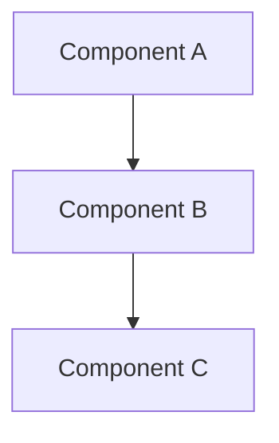

# Architecture — [Project Name]

> Executive index of architectural decisions. Each significant choice is recorded
> as an ADR in `docs/adr/` following the [MADR](https://adr.github.io/) format.
<!-- Delete all HTML comments once the placeholders are filled. -->

<!-- One row per ADR; keep Status and Date current as decisions evolve. -->
## Decision Index

| ADR | Title | Status | Date |
|-----|-------|--------|------|
| [ADR-001](adr/adr-template.md) | [Decision title] | Accepted | YYYY-MM-DD |
| [ADR-002](adr/adr-template.md) | [Decision title] | Proposed | YYYY-MM-DD |

<!-- Describe components, layers and dependency rules; edit the Mermaid nodes to match. -->
## Architecture Overview

<!-- One line per decision: what was chosen and why it shapes the codebase. -->
## Key Decisions Summary

1. **[Decision Title]** (ADR-001) — Brief rationale
2. **[Decision Title]** (ADR-002) — Brief rationale

<!-- Add style guides and diagram references used by this architecture. -->
## References

- [MADR GitHub](https://adr.github.io/) — Architecture Decision Records
- [C4 Model](https://c4model.com/) — Architecture diagrams
- [ADR Tools](https://github.com/joelparkerhenderson/architecture-decision-record) — ADR examples and tools
