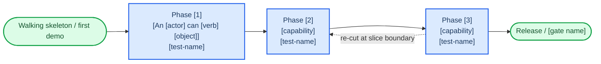

# Implementation roadmap — [Product] v[MVP]
[Date] | [Author] | [Scope class: Prototype / MVP / Enterprise] | [Methodology: ... — chosen because [signal]]
<!-- Delete all HTML comments once the placeholders are filled. -->

## 1. Phase Overview

<!-- One row per capability: name its demo, test and rollback; order by risk. -->
<!-- Roadmap overview: each phase is a capability, not a layer; arrows show delivery order. Delete this note when the agent sets the roadmap. -->

| Phase | Capability | Touchpoints | Acceptance test | Rollback | Dependency |
|-------|------------|-------------|-----------------|----------|------------|
| [1] | [An [actor] can [verb] [object]] | [contract / logic / persistence / UI / ops] | [test-name — observable assertion] | [flag off / revert commit / down-migration] | [none] |
| [2] | [An [actor] can [verb] [object]] | [contract / logic / persistence / UI / ops] | [test-name — observable assertion] | [flag off / revert commit / down-migration] | [Phase 1] |
| [3] | [An [actor] can [verb] [object]] | [contract / logic / persistence / UI / ops] | [test-name — observable assertion] | [flag off / revert commit / down-migration] | [Phase 1] |

<!-- Name the phase after its capability; fill one checklist per phase. -->
## 2. Phase detail — Phase [N]

- [ ] Demoable outcome — [when the phase ends, [actor] can [verb] [object], in one sentence].
- [ ] Acceptance test — [[test-name] proves [observable behaviour]].
- [ ] Touchpoints — [contract] / [logic] / [persistence] / [UI] / [ops].
- [ ] Rollback — [flag off / revert commit / down-migration].
- [ ] Explicitly out of scope — [what this phase deliberately does not do].
- [ ] Dependency — [none / Phase [N]].

<!-- Write the acceptance test before the slice; attach each evidence level to the slice. -->
## 3. Testing and evidence per slice

| Level | What it proves | Scope |
|-------|----------------|-------|
| [Acceptance] | [The capability is observable to an actor] | [Slice demo script named in the roadmap table] |
| [Slice] | [The end-to-end path works across every touchpoint] | [contract / logic / persistence / UI / ops in this slice] |
| [Contract] | [Touchpoints agree on their shared boundary] | [schema / API changes introduced by this slice] |
| [Regression pin] | [Earlier slices still work after this one ships] | [assertions added when this slice ships] |

<!-- Gates fix when a scope class may deliver; attach each to a slice boundary. -->
## 4. Gates and formal reviews

| Gate | Evidence accepted | Slice that produces it | Verifier | Decision |
|------|-------------------|------------------------|----------|----------|
| [gate name] | [demo of [capability] plus [test-name] result] | [Phase [N] / slice name] | [role or body] | [go / no-go, with the reason] |
| [gate name] | [demo of [capability] plus [test-name] result] | [Phase [N] / slice name] | [role or body] | [go / no-go, with the reason] |

<!-- Record early-warning signals and the slice that retires each risk. -->
<!-- Re-cut slices when a signal changes; record the new signal with the decision. -->
## 5. Risk, metrics and change control

| Risk | Signal | Slice that retires it | Rollback |
|------|--------|-----------------------|----------|
| [risk] | [observable early warning] | [Phase [N] / slice name] | [flag off / revert commit / down-migration] |
| [risk] | [observable early warning] | [Phase [N] / slice name] | [flag off / revert commit / down-migration] |

- Lead time: [target, from slice start to demo]
- Feedback loop length: [target, from demo to a decision informed by it]
- Demoable phases shipped: [target, count of phases with a passing acceptance test and an exercised rollback]
- Defects escaped: [target, defects found after a phase demo]

<!-- Tick each box only when the roadmap evidence exists. -->
## 6. Final verification

- [ ] [Every phase name is a capability, and the first is demoable.]
- [ ] [Every phase has all six output columns filled, including rollback.]
- [ ] [The phase count matches the scope range, or the exception is written down.]
- [ ] [The methodology choice is explained by a recorded signal, not by habit.]
- [ ] [Mandatory gates appear as boundaries or as tasks inside the slice they protect.]
- [ ] [Slices are ordered by risk, with the least-known or most irreversible one early.]
- [ ] [No phase exists only to produce a document or a plan.]
- [ ] [Each shared component in [shared path] has a second consumer.]
- [ ] [You can answer "what can a user do after each phase?" without opening the code.]

<!-- Log the external sources for the user's project here as the work progresses; verify each source before adding it. -->
## External References
| Source | What to consult it for | URL |
|--------|------------------------|-----|
| [source] | [what it informed for this roadmap] | [URL or citation] |
