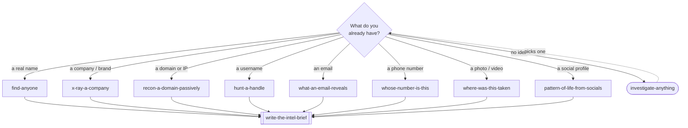
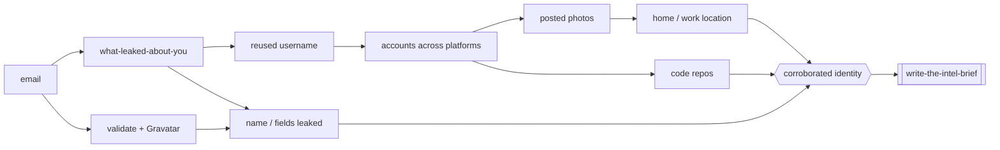
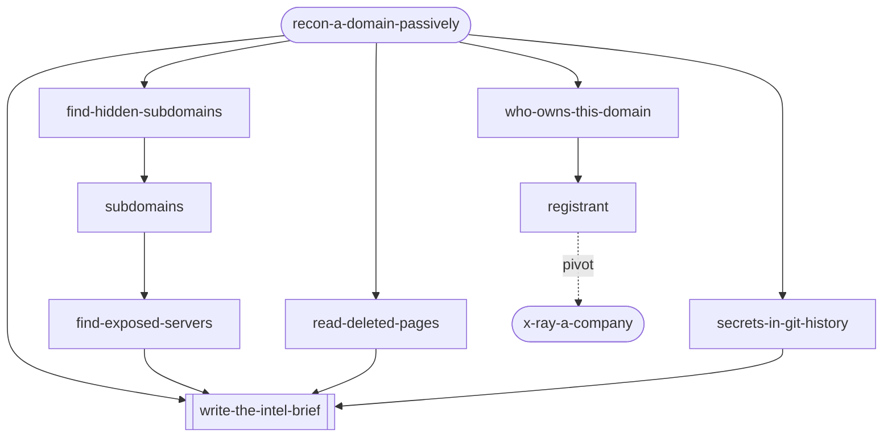

# OSINT — Investigation Router

**Open-source intelligence, run by your agent.**

Reconnaissance · Attribution · GEOINT · Breach checks · Due diligence

28 investigation skills plus 1 CTF bundle, already installed in this vault under
`tools/`. Two kinds:

- **10 workflows you run by name** — end-to-end investigations for a person,
  company, domain, username, email, phone, photo, or social account.
- **18 techniques the agent pulls in as needed** — the individual methods those
  workflows chain (reverse image search, WHOIS, certificate transparency,
  breach lookups, chronolocation, and so on).
- **1 extra (`ctf`)** — CTF-challenge bundle (DNS, metadata, archives,
  dorking, Tor relays, hash/coordinate ID). Not user-invocable; reference only.

Point the agent at a target. It picks the workflow, chains the techniques, and
hands back a brief where every claim has a source and a confidence level.

These are not cheat sheets. Each tool carries the tradecraft that separates a
lead from a finding — where each source lies, which results are tool artefacts,
and what it takes to call something confirmed. Each ships with `reference/`
material: query cookbooks, per-country indicator guides, registry catalogues,
and format tables.

> Your knowledge of breach corpora, data-broker coverage, registry endpoints
> and platform APIs may be outdated. **Prefer retrieval over pre-training** —
> read the routed `tools/*.md` and its `reference/` before acting. When a
> reference and the live documentation disagree, trust the live documentation.

## What a run looks like

```text
> recon-a-domain-passively example.com

scope        passive only, no scanning
whois        NameCheap, created 2019-03-11, registrant behind privacy guard
dns          MX → Google Workspace · SPF lists sendgrid + mailgun
crt.sh       14 subdomains, incl. staging.example.com and vpn.example.com
shodan       vpn:443 Fortinet · staging exposes :8080 Jenkins (no auth)
wayback      2021 team page named 6 staff, since deleted

pivoted 3 staff → LinkedIn, flagged the open Jenkins, wrote report.md
```

Illustrative — a real run depends on the target and which APIs you hold keys
for. The skills are the technique and the tooling; some tools (Shodan, HIBP,
DeHashed) want their own API key, and free alternatives are called out inline
in each tool file.

## Use in this vault

No install step — this skill ships with the vault. To use it:

1. State the authorised scope (Step 1 below, [ETHICS.md](ETHICS.md) first).
2. Route on the selector you hold (Step 2) and read that `tools/*.md` file.
3. Follow the workflow, pulling techniques as it directs; finish with the
   intel brief (Step 4).

## When to use / When NOT to use

| Use for | Do NOT use for |
|---|---|
| Vetting a person, supplier, counterparty, hire, seller | Doxxing, stalking, or locating a private individual in person |
| Verifying an email, invoice, domain, claim, photo, or video | Logging into accounts that are not yours |
| Due diligence, KYB/KYC, UBO, sanctions/PEP, AML, fraud triage | Using leaked credentials or acting on them |
| Attack-surface review of your own / authorised scope (passive) | Active scanning of systems you do not own |
| Journalism, fact-checking, breach-exposure audit | Harassing, embarrassing, or confronting a subject |

Every workflow assumes a documented lawful basis. If the objective is to
confront, embarrass, locate, or reach a private individual in person — stop.

## Step 1 — Scope before you collect

Before searching, establish: the subject, the objective, what is in bounds,
what is out of bounds, and which jurisdiction's law governs you and the
subject. Read [ETHICS.md](ETHICS.md) first.

**Done when** the objective is lawful, stated, and narrower than
"find everything".

## Step 2 — Route on the selector you hold

Vague request or nothing yet → [investigate-anything](tools/investigate-anything.md):
turns it into an answerable question, writes a collection plan, picks the workflow.

| You hold | Workflow |
|---|---|
| A person's name | [find-anyone](tools/find-anyone.md) |
| A company, brand, or website | [x-ray-a-company](tools/x-ray-a-company.md), then [who-really-owns-it](tools/who-really-owns-it.md) for ownership |
| A domain, website, or IP | [recon-a-domain-passively](tools/recon-a-domain-passively.md) |
| An email address | [what-an-email-reveals](tools/what-an-email-reveals.md) |
| A phone number | [whose-number-is-this](tools/whose-number-is-this.md) |
| A username or handle | [hunt-a-handle](tools/hunt-a-handle.md) |
| A photo or video | [where-was-this-taken](tools/where-was-this-taken.md) full workflow; [is-this-photo-real](tools/is-this-photo-real.md) for authenticity; [find-the-original-image](tools/find-the-original-image.md) for provenance |
| A crypto address or transaction | [follow-the-crypto](tools/follow-the-crypto.md) |
| A tail number, callsign, IMO, or MMSI | [track-planes-and-ships](tools/track-planes-and-ships.md) |
| A breach claim, credential, or combolist | [what-leaked-about-you](tools/what-leaked-about-you.md), then [find-leaks-in-the-wild](tools/find-leaks-in-the-wild.md) |
| Confirmed social accounts | [pattern-of-life-from-socials](tools/pattern-of-life-from-socials.md) |
| A finished evidence set | [write-the-intel-brief](tools/write-the-intel-brief.md) |

Business framings map onto the same workflows:

| The ask | Route |
|---|---|
| Vet supplier / counterparty / vendor before signing or paying | [x-ray-a-company](tools/x-ray-a-company.md) → [who-really-owns-it](tools/who-really-owns-it.md) → [who-owns-this-domain](tools/who-owns-this-domain.md) |
| Is this invoice or payment change genuine? | [what-an-email-reveals](tools/what-an-email-reveals.md) → [whose-number-is-this](tools/whose-number-is-this.md) → [who-owns-this-domain](tools/who-owns-this-domain.md) |
| Is this job offer, recruiter, or marketplace seller real? | [hunt-a-handle](tools/hunt-a-handle.md) → [find-the-original-image](tools/find-the-original-image.md) → [x-ray-a-company](tools/x-ray-a-company.md) |
| KYB / UBO / sanctions screening | [who-really-owns-it](tools/who-really-owns-it.md) → [x-ray-a-company](tools/x-ray-a-company.md) |
| What is our external attack surface? | [recon-a-domain-passively](tools/recon-a-domain-passively.md) → [find-hidden-subdomains](tools/find-hidden-subdomains.md) → [find-exposed-servers](tools/find-exposed-servers.md) |
| What leaked about our executives? | [what-leaked-about-you](tools/what-leaked-about-you.md) → [dig-through-data-brokers](tools/dig-through-data-brokers.md) → [find-leaks-in-the-wild](tools/find-leaks-in-the-wild.md) |
| Is this image or claim authentic? | [is-this-photo-real](tools/is-this-photo-real.md) → [find-the-original-image](tools/find-the-original-image.md) → [geolocate-from-pixels](tools/geolocate-from-pixels.md) |

Several workflows are deliberately not auto-invoked — they carry scope gates
and must be entered by name. Naming them from here is the intended path.

## Step 3 — Work cheapest and least intrusive first

Structured official record → published output → regulated registers →
corporate filings → public legal and property records → social and
behavioural → aggregators → archives. Do not start with data brokers; they
hand you plausible wrong answers before you have any way to reject them.

Before touching anything that could tip off the subject, read
[investigate-without-getting-made](tools/investigate-without-getting-made.md)
(attribution surface, sockpuppet persona, VPN/proxy/Tor choice).

## Step 4 — Grade before you report

Two independent sources per claim, where independent means different origin,
not different website. Grade the identity attribution separately from the
claim itself — a record can be entirely genuine and still not be your subject.
Record negative findings; an absence is a finding, not a gap to hide.

Hand off to [write-the-intel-brief](tools/write-the-intel-brief.md).

## Where to start



## How a case actually moves

A case is a chain of pivots. One known selector turns into the next until the
picture holds together under more than one source.

Start with an email and it can unfold like this:



Every hop is one of the technique skills; nothing gets called a fact off a
single weak match. A workflow is never one lookup —
[recon-a-domain-passively](tools/recon-a-domain-passively.md) fans out across
several techniques at once:



## Tool index — all 29

### Workflows — you type these (10)

| Tool | Purpose in one line |
|---|---|
| [investigate-anything](tools/investigate-anything.md) | Start-here router: scope gate, collection plan, grading, picks the workflow. |
| [find-anyone](tools/find-anyone.md) | Profile an individual from public records without fusing two people. |
| [x-ray-a-company](tools/x-ray-a-company.md) | Due diligence: entity, ownership, people, infra, risk. |
| [recon-a-domain-passively](tools/recon-a-domain-passively.md) | Map a domain/site/IP (registration, DNS, infra, history) without touching it. |
| [hunt-a-handle](tools/hunt-a-handle.md) | Enumerate a username across platforms, then prove same-person. |
| [what-an-email-reveals](tools/what-an-email-reveals.md) | Validate an address, find its accounts, trace a suspicious message. |
| [whose-number-is-this](tools/whose-number-is-this.md) | Line type, carrier, VoIP/burner detection, messaging-app exposure. |
| [where-was-this-taken](tools/where-was-this-taken.md) | Photo/video: metadata → provenance → geolocation → time, with confidence. |
| [pattern-of-life-from-socials](tools/pattern-of-life-from-socials.md) | Network, content, and posting rhythm from social profiles. |
| [write-the-intel-brief](tools/write-the-intel-brief.md) | Turn findings into a sourced brief separating fact from inference. |

### Techniques — the agent pulls these in as needed (18)

| Tool | Purpose in one line |
|---|---|
| [find-the-original-image](tools/find-the-original-image.md) | Reverse image search for first publication across Yandex, Lens, Bing, TinEye. |
| [secrets-in-file-metadata](tools/secrets-in-file-metadata.md) | EXIF/Office/PDF metadata: GPS, device, authors, edit chains. |
| [who-owns-this-domain](tools/who-owns-this-domain.md) | WHOIS/RDAP/DNS: registrar, registrant, SPF/DKIM/DMARC vendors. |
| [find-hidden-subdomains](tools/find-hidden-subdomains.md) | Subdomains and siblings from CT logs and passive DNS. |
| [read-deleted-pages](tools/read-deleted-pages.md) | Deleted/edited web content via Wayback CDX, archive.today, Common Crawl. |
| [google-like-a-spy](tools/google-like-a-spy.md) | Search operators and dorks for hidden files and mentions. |
| [secrets-in-git-history](tools/secrets-in-git-history.md) | Commit emails, deleted forks, and leaked credentials in git history. |
| [geolocate-from-pixels](tools/geolocate-from-pixels.md) | Place and time from visual evidence alone (plates, shadows, sun angle). |
| [investigate-without-getting-made](tools/investigate-without-getting-made.md) | OPSEC: attribution surface and non-leaking research persona. |
| [what-leaked-about-you](tools/what-leaked-about-you.md) | Breach exposure via HIBP k-anonymity, DeHashed, IntelX; never touch credentials. |
| [follow-the-crypto](tools/follow-the-crypto.md) | Trace wallets/transactions: clustering, bridges, off-ramps, sanctions. |
| [track-planes-and-ships](tools/track-planes-and-ships.md) | Aircraft/vessels via ADS-B/AIS: tail/ICAO, IMO/MMSI, dark-fleet gaps. |
| [find-exposed-servers](tools/find-exposed-servers.md) | Exposed hosts/services via Shodan/Censys scan data, never direct probing. |
| [find-leaks-in-the-wild](tools/find-leaks-in-the-wild.md) | Pastes, forums, Telegram leaks; fresh leak vs recycled combolist. |
| [is-this-photo-real](tools/is-this-photo-real.md) | Authenticity: provenance first, pixels last, honest AI-detector limits. |
| [dig-through-data-brokers](tools/dig-through-data-brokers.md) | Broker records as leads only, plus the FCRA line not to cross. |
| [who-really-owns-it](tools/who-really-owns-it.md) | Beneficial ownership via registries, filings, LEI, offshore datasets. |
| [graph-the-network](tools/graph-the-network.md) | Link-analysis graph: typed edges with source, bridging nodes. |

### Extra (1)

| Tool | Purpose in one line |
|---|---|
| [ctf](tools/ctf.md) | CTF-only bundle (DNS, metadata, archives, dorking, Tor, hash/ID); not a case workflow. |

## Reference index

`reference/` (50 files) holds the cookbooks and catalogues the tools cite.
Read the one your tool points at; families:

- **Search:** dork-cookbook, engine-matrix, engine-operators, query-cookbook.
- **People:** find-anyone-source-catalogue, dig-through-data-brokers-source-catalogue, identifiers, name-pattern-triage, address-formats, line-types.
- **Company/ownership:** registry-catalogue, corporate-formats, filing-interpretation, diligence-checklist, shell-company-red-flags.
- **Infra/DNS:** dns-record-types, web-and-dns, subdomain-sources, vendor-fingerprints, banner-interpretation, asset-inventory.
- **Archives/code:** cdx-cookbook, archive-comparison, git-archaeology.
- **Media/geo:** geolocation-and-media, exiftool-cookbook, authenticity-triage, chronolocation, preprocessing.
- **Breach/leak:** data-sources, what-leaked-about-you-source-catalogue, find-leaks-in-the-wild-source-catalogue, platform-leakage, platform-disclosure, header-fields, format-permutations.
- **Social/graph:** social-media, record-fields, schema-starter, high-signal-indicators, regional-indicators, variant-patterns, tag-catalogue.
- **Reporting/tradecraft:** analytic-checklist, source-grading, estimative-language, verification-checklist, report-template, ach-worksheet, attribution-surface, persona-runbook, tool-catalogue, tool-comparison, tools-mcp, explorers-and-tools.

## Where this goes wrong

- **Skipping scope.** The most common failure is collecting first and justifying later.
- **Name collision.** Never search a name alone; bind it to a second selector first.
- **Aggregators laundering each other.** Three brokers agreeing is one source.
- **Over-trusting a photo match.** A shared image proves shared images, not shared identity.
- **Treating a sparse footprint as concealment.** It usually means a private person, a non-English footprint, or closed registries.
- **Reading ELA / AI-detector output as verdict.** See [is-this-photo-real](tools/is-this-photo-real.md) limits.

## Verification checklist

- [ ] Scope stated and [ETHICS.md](ETHICS.md) read before any collection.
- [ ] Correct workflow picked for the starting selector (Step 2).
- [ ] Cheapest/least-intrusive order kept; OPSEC read before sensitive touches.
- [ ] Two independent origins per claim; identity graded separately from claim.
- [ ] Negative findings and gaps recorded, not hidden.
- [ ] Brief written via [write-the-intel-brief](tools/write-the-intel-brief.md) with per-claim sources, timestamps, archived copies.
