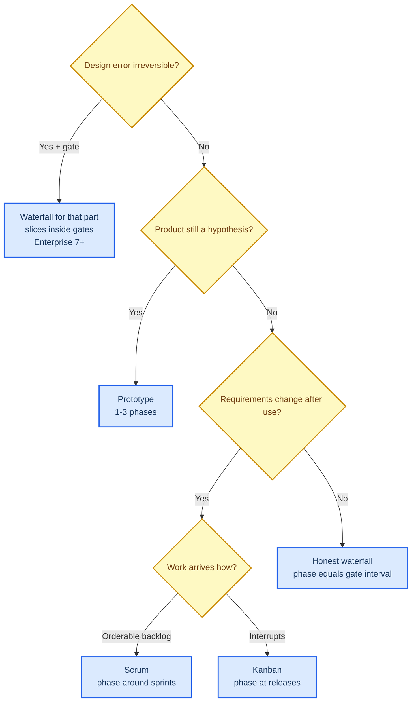

# Vertical Slice Architecture

A vertical slice is one user-visible capability delivered end to end — input, logic, persistence, output — so every phase ships something a person can use and a test can prove. Plan by capability, not by layer: "user can reset their password" is a slice; "build the database layer" is not.

Read the reference files only for the question at hand: methodology choice, slice mechanics, sequencing, or a concrete example. They hold the detail so this index stays usable in a single glance.

## When to Use (and When NOT to)

| Use When | Skip When |
|----------|-----------|
| Planning implementation phases for a feature, spec, or migration | The work is a single-file change with no roadmap |
| Writing or revising an implementation roadmap | The roadmap already exists and you are only executing a phase |
| Choosing between waterfall/cascade and agile delivery | The organisation mandates a process you cannot change |
| Deciding how many phases a scope needs | The phase count is fixed by an external contract |
| A roadmap is layer-shaped (DB → API → UI) and keeps slipping | Pure research spikes with no deliverable |
| Phase 1 has never been demoed | |

**Rule of thumb:** the smaller the feedback loop, the more slices; the more frozen the scope, the more a sequential plan is honest rather than harmful.

## How to Decide the Methodology

Waterfall and agile are not moral choices — they price the cost of being wrong. Pick the model whose failure mode you can afford.

| Signal | Ask | Lean waterfall/cascade | Lean agile |
|--------|-----|------------------------|------------|
| **Requirement stability** | Can scope change after sign-off? | Frozen, contractually fixed, change is expensive | Discovered by use, change is expected |
| **Feedback loop length** | How long until a user sees it? | Weeks-months; release windows controlled externally | Hours-days; deploy on demand |
| **Team size** | How many people must agree? | 1-3 with external review, or many teams on fixed interfaces | 3-9 co-located, or many teams owning separate slices |
| **Regulatory/contractual gates** | Are external gates mandatory? | Certification, audit, fixed-price milestone, safety case | Internal review only, or gates that accept incremental evidence |
| **Blast radius** | What breaks if the design is wrong? | Unrecoverable: safety, money movement, destructive migrations | Recoverable behind a flag, feature toggle, or revert |

Three consequences worth stating plainly:

1. **Waterfall as container, agile as inside.** Keep mandatory gates (audit, certification, procurement) as fixed outer milestones; inside each milestone, still plan vertical slices. Gates do not force layer-by-layer work.
2. **Agile does not mean no plan.** It means the plan is a hypothesis you revise at each slice boundary. A roadmap with no phase boundaries is not agile, it is unplanned.
3. **Mixed is normal.** A safety-critical subsystem can be waterfall (frozen interface, formal verification) while the surrounding product is agile. Record the split and the seam.

If two signals conflict (frozen scope but a one-week feedback loop), prefer **agile** and honour the gate: the gate constrains *when* you may ship, not *how* you build.



The full tree and its seven worked scenarios are in [DECISION-GUIDE.md](./references/DECISION-GUIDE.md).

## Phase Count by Scope

| Scope | Phases | Signals |
|-------|--------|---------|
| **Prototype** | 1-3 | Unknown requirements, throwaway code, one developer |
| **MVP** | 4-6 | Known user, iterating on feedback, small team |
| **Enterprise** | 7+ | Multiple teams, compliance gates, long-lived system |

The range is a sanity check, not a quota. Too few phases usually means a phase bundles unrelated capabilities; too many usually means a phase exists only to produce another plan. Justify any phase count outside the range before writing it down.

## Cascade Thinking Inside an Agile Project (Anti-Patterns)

| Anti-pattern | Symptom | Fix |
|--------------|---------|-----|
| **Layer phases** | "Phase 1: schema. Phase 2: service layer. Phase 3: UI." | Re-cut by capability; each phase crosses all layers |
| **Big-bang integration** | Components meet for the first time in the last phase | Every slice integrates with what exists |
| **Undemoable phase** | Status report is "80% done", nothing to click | Each phase ends with a demoable outcome |
| **Plan-only phase** | The deliverable is a design doc, a spec, or a refined plan | Fold it into the slice that needs it, or delete it |
| **Horizontal task list** | Tasks grouped by file, module, or technology | Group tasks under the slice they serve |
| **Phase-per-person** | Phases mirror the team chart | Phases mirror capabilities; assign people to slices |
| **Infra phase zero** | Weeks of scaffolding before any behaviour | Ship a thin walking skeleton, then thicken it |
| **Risk last** | Unknowns are scheduled for the end | Riskiest or least-known slice goes first |

## The Vertical Cut Algorithm

Apply in order. Do not assign phases before step 6.

1. **List capabilities.** Enumerate what an actor can *do* after the work ships, as verbs with an object ("import a CSV", "approve an invoice"). One capability per line; no technology words.
2. **Pick the thinnest end-to-end path.** Choose the capability that is narrowest yet still traverses every layer, preferring the one with the highest risk or the most unknowns.
3. **List the touchpoints it crosses.** Contract/schema, domain logic, persistence, transport or UI, operations (config, logging, permissions). This list is the vertical cut — if any touchpoint is missing, the slice is not vertical.
4. **Write the acceptance test that proves the slice.** The test is the definition of done and the demo script. If you cannot name the assertion, the slice is too vague to schedule.
5. **Order slices by risk and dependency.** Unknowns and irreversible decisions first; pure prerequisites only when they literally block a slice ("cannot store anything until the schema exists"), and then fold the prerequisite into that slice.
6. **Assign phases.** Group one or more completed slices into a phase, then check the count against the Prototype/MVP/Enterprise range. Name each phase after its capability, never after a layer.

## Output Format

Deliver the roadmap as one table with these six columns, in phase order. The columns force each phase to state what a user gets, how it is proven, and how it is undone — the three questions a layer-shaped plan cannot answer.

```markdown
# Implementation roadmap — <scope class> (<N> phases)

| Phase | Capability | Touchpoints | Acceptance test | Rollback | Dependency |
|-------|------------|-------------|-----------------|----------|------------|
| 1 | An <actor> can <verb> <object> | <contract / logic / persistence / UI / ops> | `<test-name>` — <observable assertion> | <flag off / revert commit / down-migration> | none |
| 2 | An <actor> can <verb> <object> | <...> | `<test-name>` — <observable assertion> | <...> | Phase 1 |

Methodology: <waterfall container / Scrum / Kanban / hybrid> — because <the signal that decided it>.
Deliberately out of scope: <capabilities deferred, with the reason>.
```

Fill every cell. A blank "Rollback" usually means the phase changes data irreversibly — split that phase, or add a down-migration before scheduling it. See [EXAMPLES.md](./references/EXAMPLES.md) for a filled roadmap and a layer-to-slice rewrite.

## When a Slice Resists the Cut

| Situation | What to do | Why |
|-----------|-----------|-----|
| **Slice too large** for one planning unit | Narrow the capability (one actor, one state transition, happy path first); do not extend the unit to fit the slice | A slice that cannot be demoed inside the unit has become a mini-project |
| **Two slices always ship together** | Merge them, or find the capability that truly separates them | Separate deployments that always co-deploy are one slice with two names |
| **Slice B depends on slice A** | Keep A as its own phase only if A alone is demoable; otherwise fold the prerequisite into B | A standalone "foundation" phase is a layer in disguise |
| **Temptation to add a shared abstraction** | Require a second consumer with a different slice; until then duplicate the few lines | Premature sharing couples slices and hides the real axis of change |
| **Risk discovered mid-cut** | Re-order: bring the uncertain slice forward, even if the sequence feels less tidy | Learning late is the most expensive place to learn |

Narrowing keeps the cut vertical: remove *behaviour*, never a *layer*. Dropping persistence to make a slice smaller produces a demo that cannot survive a restart — that is a stub, not a slice.

## Glossary

| Term | Meaning here |
|------|--------------|
| **Slice** | The smallest change delivering a complete, user-observable capability across every layer it needs. |
| **Capability** | Something an actor can do after the phase ships, phrased as a verb with an object. |
| **Touchpoint** | A layer or contract the slice must cross (schema, logic, persistence, transport/UI, ops). |
| **Phase** | One or more slices grouped into a demoable, revertible unit with an acceptance test. |
| **Walking skeleton** | The thinnest slice that connects all major components; proves the path, not the value. |
| **Gate** | An external approval point (audit, certification, contract) that fixes *when* you may ship. |
| **CQRS slice** | A slice where read and write shapes genuinely differ, so command and query are separate slices. |
| **DoD** | Definition of Done: the shared checklist that decides whether a slice counts as finished. |

## What a Phase Must Contain

- [ ] **Demoable outcome** — who can do what when the phase ends, in one sentence.
- [ ] **Acceptance test** — name of the test and the behaviour it proves.
- [ ] **Touchpoints** — the layers and contracts the slice crosses (one line, not a task list).
- [ ] **Rollback** — feature flag off, revert commit, or down-migration; state which.
- [ ] **Explicitly out of scope** — what this phase deliberately does not do.
- [ ] **Dependency** — the phase it needs, or "none".

## Red Flags

- A phase title containing "layer", "database", "API", or "frontend" — it is horizontal.
- More than one phase before the first demo.
- A phase whose tasks could all be done twice as fast by deleting it.
- Acceptance criteria written as "code complete" or "tests pass" with no behaviour named.
- A roadmap that cannot answer "what can a user do after phase 2?".
- Phase count outside 1-3 / 4-6 / 7+ without a written justification.
- A "Rollback" column full of dashes — the plan assumes nothing can go wrong.

## Final verification

- [ ] Every phase name is a capability, and the first is demoable.
- [ ] Every phase has all six output columns filled, including rollback.
- [ ] The phase count matches the scope range, or the exception is written down.
- [ ] The methodology choice is explained by a signal (feedback loop, gate, blast radius), not by habit.
- [ ] Mandatory gates appear as boundaries or as tasks inside the slice they protect.
- [ ] Slices are ordered by risk, with the least-known or most irreversible one early.
- [ ] No phase exists only to produce a document or a plan.
- [ ] Each shared component in `shared/` has a second consumer.
- [ ] You can answer "what can a user do after each phase?" without opening the code.

## Reference index

Read only the file for the question at hand. Methodology files share one seven-section shape; cross-cutting files apply to every methodology.

### Traditional / plan-driven

| File | Purpose |
|------|---------|
| [WATERFALL.md](./references/WATERFALL.md) | Sequential phases, gates, evidence packs and the hybrid of gates outside with slices inside |
| [V-MODEL.md](./references/V-MODEL.md) | Pairing each design activity with a test level; verification versus validation |
| [SPIRAL.md](./references/SPIRAL.md) | Risk-driven cycles, anchor milestones and Boehm's six invariants |
| [ITERATIVE-INCREMENTAL.md](./references/ITERATIVE-INCREMENTAL.md) | Repeating the process and growing the product; history and failure modes |
| [PROTOTYPING.md](./references/PROTOTYPING.md) | Throwaway versus evolutionary prototypes, and prototypes versus walking skeletons |
| [RAD.md](./references/RAD.md) | Rapid Application Development, JAD workshops and time-boxed parallel construction |
| [STAGE-GATE.md](./references/STAGE-GATE.md) | Investment decision gates, go/no-go criteria and gate evidence |
| [RUP.md](./references/RUP.md) | Rational Unified Process phases, milestones, disciplines and tailoring |

### Agile and lean

| File | Purpose |
|------|---------|
| [AGILE.md](./references/AGILE.md) | Family umbrella: values, principles and when to adopt agile; no framework detail |
| [SCRUM.md](./references/SCRUM.md) | Sprints, roles, artifacts and the Definition of Done as a phase boundary |
| [KANBAN.md](./references/KANBAN.md) | Flow, WIP limits, explicit policies and pull criteria |
| [XP.md](./references/XP.md) | Extreme Programming's engineering practices: TDD, pairing, CI, refactoring |
| [LEAN.md](./references/LEAN.md) | Waste, flow, late decisions and systems thinking |
| [FDD.md](./references/FDD.md) | Feature-driven development, the overall model and binary progress |
| [DSDM.md](./references/DSDM.md) | Fixed time and cost with variable scope, MoSCoW and governance |
| [ASD.md](./references/ASD.md) | Adaptive Software Development's speculate-collaborate-learn cycle |
| [SHAPE-UP.md](./references/SHAPE-UP.md) | Shaping, appetites, six-week cycles and the betting table |
| [SCALED-AGILE.md](./references/SCALED-AGILE.md) | SAFe, LeSS, Nexus and Scrum@Scale compared by scaling problem |
| [CRYSTAL.md](./references/CRYSTAL.md) | Cockburn's method family sized by team size and criticality |
| [DEVOPS.md](./references/DEVOPS.md) | Delivery pipeline, shared ownership and production feedback |
| [AUP.md](./references/AUP.md) | Agile Unified Process: RUP structure with fewer artifacts |
| [TDD-BDD.md](./references/TDD-BDD.md) | Test-first at unit and acceptance level, with Given/When/Then |

### Cross-cutting

| File | Purpose |
|------|---------|
| [VERTICAL-SLICE.md](./references/VERTICAL-SLICE.md) | Slicing heuristics, sizing, CQRS, test strategy by risk and two worked roadmaps |
| [DECISION-GUIDE.md](./references/DECISION-GUIDE.md) | Signal matrix, seven scenarios, fast triage and decision checklist |
| [EXAMPLES.md](./references/EXAMPLES.md) | A filled roadmap and a layer-shaped plan rewritten as slices |

## External References

| Source | What to consult it for | URL |
|--------|------------------------|-----|
| Agile Manifesto — Principles | Early and frequent delivery; working software as the measure of progress | https://agilemanifesto.org/principles.html |
| Jimmy Bogard — Vertical Slice Architecture | Origin of the term, coupling along the axis of change, refactoring requirement | https://www.jimmybogard.com/vertical-slice-architecture/ |
| The Scrum Guide (2020, official HTML) | Official definition of Increment and Definition of Done as a commitment | https://scrumguides.org/scrum-guide.html |
| National Academies (NRC, 2010) | History of the cascade model and Royce's "do it twice" recommendation | https://www.nationalacademies.org/read/12823/chapter/5 |
