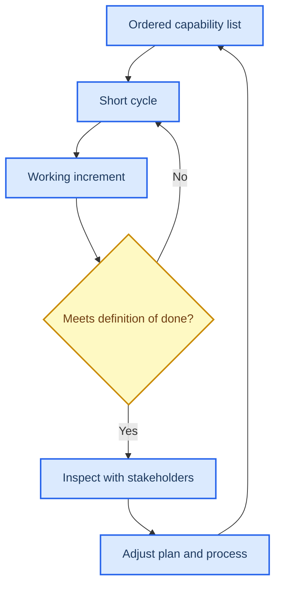

# Agile

Purpose: understand the family umbrella — values, principles and the decision to adopt it — before choosing a specific framework.

## Definition and origin

Agile is a family of approaches defined by the Manifesto for Agile Software Development (2001) and its twelve principles. Its values favour individuals and interactions, working software, customer collaboration and responding to change over their documented counterparts. Agile is not a process: it is a set of values and principles that frameworks such as Scrum, Kanban, XP and FDD interpret differently.

The operational idea is short loop between a decision and evidence that the decision was wrong. Boards, ceremonies and story points are instrumentation for that loop, not the definition of it. Agile Alliance's Agile 101 gives a broad, vendor-neutral overview of the family.

For the frameworks themselves, see [SCRUM.md](./SCRUM.md), [KANBAN.md](./KANBAN.md), [XP.md](./XP.md), [LEAN.md](./LEAN.md), [FDD.md](./FDD.md), [DSDM.md](./DSDM.md), [ASD.md](./ASD.md) and [SHAPE-UP.md](./SHAPE-UP.md).

## When it fits

- Requirements change after users touch the product, and that change is information rather than failure.
- Feedback can be gathered in days or weeks rather than months.
- Failure is recoverable behind flags, rollbacks or staged releases.
- A cross-functional team can inspect and adapt its own work.
- An organisation can tolerate a plan that is re-ordered at slice boundaries.

It fits less well when scope is contractually frozen, when an external gate controls every release, or when being wrong is unrecoverable. Those cases do not forbid agile inside the boundaries; see [WATERFALL.md](./WATERFALL.md) for the hybrid.

## How it works

1. **Work in short cycles** — time-boxed iterations or continuous flow — and deliver working software frequently.
2. **Keep a single ordered list** of what might be done; order it by value and risk.
3. **Make progress visible** with working software as the primary measure, supported by simple metrics.
4. **Inspect and adapt** at regular cadence: re-order the list, change the process, act on one improvement.
5. **Build in quality** through technical excellence, continuous integration and a shared definition of done.
6. **Choose the framework that matches the work:** Scrum for cadence, Kanban for flow, XP for engineering practices, and so on.

Agile does not remove planning. It moves planning to the boundary of each cycle and treats the roadmap as a hypothesis.

## Strengths and failure modes

| Strength | Failure mode | Symptom / correction |
|---|---|---|
| Fast feedback makes being wrong cheap | Agile in name only | Ceremonies without working increments; require a demoable outcome each cycle |
| Working software measures real progress | Story points as productivity score | Velocity compared across teams; use it only for local forecasting |
| Change is welcome late in development | Roadmap treated as a contract | Re-ordering reported as a delay; publish capabilities and order, not dates |
| Small batches reduce integration risk | Sprint as mini-waterfall | Design sprint, build sprint, test sprint; put all activities in one slice |
| Teams self-organise around outcomes | No explicit outcome | Nobody can say what is demoable this cycle; write the acceptance test first |

## Mapping to vertical slices

- A slice is the natural unit of an agile increment: a capability an actor can use when the cycle ends.
- If a slice cannot finish inside one cycle, narrow the capability rather than extend the cycle.
- The ordered backlog is the roadmap; each slice carries its acceptance test, rollback and dependency.
- Re-ordering at a slice boundary is expected behaviour, not schedule failure.
- Ceremonies should serve the loop; drop any that produce no decision or change.

## Verification questions

1. How long is the loop between a decision and evidence about it?
2. Is there something demoable at the end of each cycle?
3. Does the team re-order work based on feedback, and is that recorded without blame?
4. Which framework did you choose, and which signal decided it?
5. Are ceremonies producing changes, or only meetings?

## External References

| Source | What to consult it for | URL |
|--------|------------------------|-----|
| Manifesto for Agile Software Development | The four values and their signatories | https://agilemanifesto.org/ |
| Principles behind the Agile Manifesto | The twelve principles, including early delivery and welcoming change | https://agilemanifesto.org/principles.html |
| Agile Alliance — Agile 101 | Vendor-neutral overview of the agile family and its practices | https://agilealliance.org/agile101/ |
| Wikipedia — Agile software development (index only) | Historical context and the range of agile methods | https://en.wikipedia.org/wiki/Agile_software_development |
