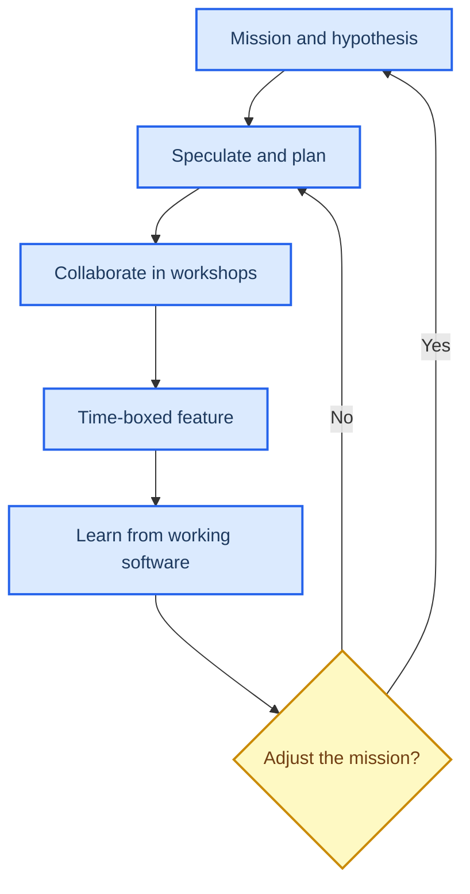

# Adaptive Software Development

Purpose: use the speculate-collaborate-learn cycle when the problem changes faster than a plan can be kept current.

## Definition and origin

Adaptive Software Development (ASD) was created by Jim Highsmith and Sam Bayer in the 1990s as an alternative to rigid, plan-driven development for complex systems. It replaces the linear plan-build-rework sequence with three overlapping, non-sequential activities: **speculate, collaborate, learn**.

ASD is a direct ancestor of several agile ideas: adaptive planning, feature-based decomposition, time-boxed releases, and the view that a project is a search for a viable solution rather than execution of a known plan.

## When it fits

- Requirements and technology are both changing during development.
- The team can collaborate intensively and self-organise.
- Extreme programming practices are unavailable or inappropriate, but a lightweight adaptive process is still needed.
- Leadership can tolerate plans that are explicitly provisional.

It is a poor fit when scope is fixed by contract, when collaboration across the team is impossible, or when the organisation requires detailed up-front estimates.

## How it works

1. **Speculate:** set a mission and a release plan that are explicit hypotheses; plan at a level that can be revised.
2. **Collaborate:** use joint workshops, paired work and shared ownership; make decisions where the knowledge is.
3. **Learn:** review working software, customer feedback and technical results; adjust the plan and the product.
4. **Use feature-based decomposition:** break the mission into customer-valued features and release them in time boxes.
5. **Manage by results, not activities:** measure whether the mission is being approached, not whether the process was followed.
6. **Keep the cycle overlap:** speculation, collaboration and learning happen together, not as sequential phases.

## Strengths and failure modes

| Strength | Failure mode | Symptom / correction |
|---|---|---|
| Plans survive changing requirements | Speculation becomes a fixed plan | "Hypothesis" never revised; require a learning step that changes it |
| Collaboration surfaces hidden assumptions | Workshops without decorators | Decisions made by the loudest voice; use facilitated sessions |
| Learning is a named activity, not a retrospective afterthought | No feedback source | Learning meetings with no data; bring working software and metrics |
| Feature focus keeps delivery customer-valued | Features split by component | Nothing usable until all parts ship; cut by capability |
| Works without a heavy process | Lack of structure | Chaos mistaken for adaptation; keep time boxes and missions explicit |

## Mapping to vertical slices

- The mission map becomes the capability list; each feature is a candidate slice.
- Speculation assigns a slice to a time box; collaboration builds it; learning is the acceptance test and review.
- A slice that does not fit the time box is narrowed, not extended.
- Record what each slice taught you and use it to re-order the next release plan.
- Keep learning evidence in the slice: test results and user reactions, not meeting notes.

## Verification questions

1. Is the current plan labelled and treated as a hypothesis?
2. What did the last slice teach you, and what did you change because of it?
3. Are features customer-valued capabilities or technical components?
4. Do planning, collaboration and learning overlap rather than run as phases?
5. Is progress measured by working features rather than completed activities?

## External References

| Source | What to consult it for | URL |
|--------|------------------------|-----|
| Jim Highsmith — official site | Materials and writing from the co-creator of ASD | https://www.jimhighsmith.com/ |
| Wikipedia — Adaptive software development (index only) | Speculate-collaborate-learn cycle and history | https://en.wikipedia.org/wiki/Adaptive_software_development |
| Wikipedia — Iterative and incremental development (index only) | ASD's roots in iterative delivery | https://en.wikipedia.org/wiki/Iterative_and_incremental_development |
| Wikipedia — Agile software development (index only) | ASD among the agile methods and its influence | https://en.wikipedia.org/wiki/Agile_software_development |
