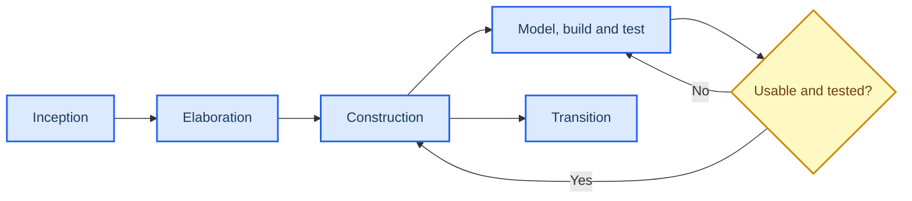

# Agile Unified Process

Purpose: apply a lightweight, use-case-driven unified process when a team wants RUP structure without RUP's artifact load.

## Definition and origin

Agile Unified Process (AUP) is Scott Ambler's simplified version of the Rational Unified Process. It keeps the unified-process ideas — iterative, incremental, use-case driven, architecture centric, risk focused — but reduces the number of artifacts and activities and applies agile practices such as test-driven development, continuous integration and agile modelling.

AUP is a member of the unified-process family alongside RUP and OpenUP. It is intended for small to medium teams that need some governance but find full RUP excessive.

## When it fits

- A team wants RUP's phase structure but not its full document set.
- Use cases are the natural way to describe the system's behaviour.
- Some governance artefacts are needed for stakeholders or auditors.
- The team is willing to tailor the process rather than follow a template.

It is a poor fit for teams wanting a minimal method such as Crystal Clear, or for organisations that require formal RUP artifacts.

## How it works

1. **Four phases:** Inception, Elaboration, Construction, Transition, each ending in a milestone.
2. **Seven disciplines:** model, implementation, test, deployment, configuration management, project management, and environment — with emphasis varying by phase.
3. **Use cases drive the work:** requirements, design, tests and documentation are organised around actor goals.
4. **Apply agile practices:** TDD, refactoring, pair programming where useful, continuous integration, and short iterations.
5. **Keep artifacts lightweight:** model in small, disposable sketches where possible; produce durable documents only when needed.
6. **Tailor and evolve:** AUP is a framework, not a prescribed process.

## Strengths and failure modes

| Strength | Failure mode | Symptom / correction |
|---|---|---|
| Governance without heavyweight documents | Reintroducing the full RUP artifact set | Team produces documents instead of software; cut artifacts |
| Use cases connect actors to tests | Use cases written as feature lists | "Login" with no goal; phrase as actor outcome |
| Agile practices keep change cheap | Skipping tests to save time | Regression rate rises; keep TDD and CI |
| Risk-focused phases | Phase names used as layer phases | "Modelling phase", "implementation phase"; name by capability |
| Tailorable to the team | Never tailored | Process overhead dominates; review and remove unused practices |

## Mapping to vertical slices

- Each AUP use case or scenario maps to a **capability slice** with a test and a rollback.
- Phase milestones become roadmap boundaries; iterations inside them deliver slices.
- In Elaboration, prove the architecture with a running walking skeleton rather than a design document.
- Model briefly before building the slice, then keep the model in the code and tests.
- Tailor away any artifact that does not change a decision or satisfy a real gate.

## Verification questions

1. Which artifacts did you keep, and which decision does each support?
2. Are use cases phrased as actor goals, not modules?
3. Is architecture proven by running code before broad construction?
4. Is the process tailored to this team's size?
5. Do phase names describe capabilities rather than disciplines?

## External References

| Source | What to consult it for | URL |
|--------|------------------------|-----|
| Wikipedia — Agile unified process (index only) | AUP phases, disciplines and relationship to RUP | https://en.wikipedia.org/wiki/Agile_Unified_Process |
| Wikipedia — Unified process (index only) | The unified-process family and tailoring | https://en.wikipedia.org/wiki/Unified_process |
| Wikipedia — Rational unified process (index only) | The framework AUP simplifies and its phase milestones | https://en.wikipedia.org/wiki/Rational_Unified_Process |
