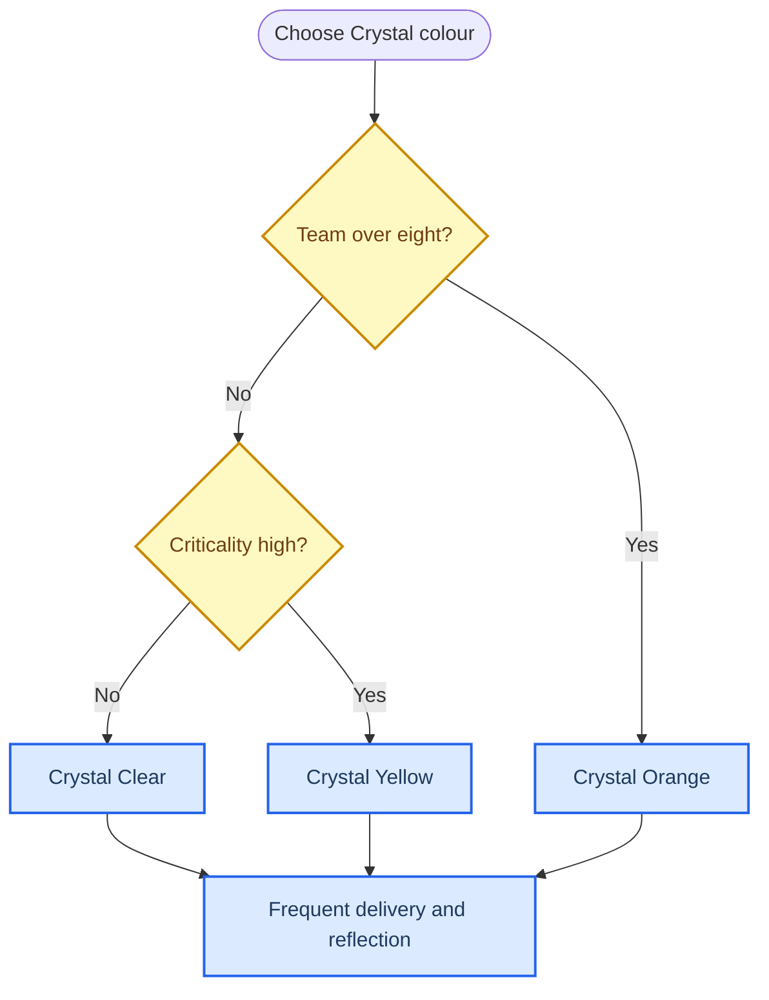

# Crystal

Purpose: match the amount of process to the team's size and criticality using Alistair Cockburn's Crystal family.

## Definition and origin

Crystal is a family of agile methodologies developed by Alistair Cockburn in the 1990s, including Crystal Clear, Crystal Yellow, Crystal Orange and others. The family's central claim is that methodology should vary with two dimensions: **team size** and **system criticality**. More people and higher criticality require more ceremony, coordination and artifact rigor; small, non-critical teams can work with very little.

Crystal Clear, the lightest member, is designed for a co-located team of up to roughly six to eight people building non-life-critical systems. Its priorities are frequent delivery, reflective improvement, close communication and individual workmanship.

## When it fits

- A small, co-located team wants an explicit minimal method rather than an ad hoc one.
- The product is not safety-critical, so heavy artifacts would add little.
- The team can communicate informally and review its own working habits.
- You need a principled reason to *remove* ceremony as the project shrinks.

It is a poor fit for large distributed programmes or safety-critical systems; those belong with heavier members of the family or with scaled frameworks.

## How it works

1. **Choose the colour** by team size and criticality.
2. **Use the properties, not a fixed recipe:** frequent delivery, reflective improvement, close communication, and a tolerant culture.
3. **Keep the product owner and users close** to the team, with direct access rather than a proxy chain.
4. **Hold short deliberative meetings** only where they change decisions.
5. **Reflect regularly** on the method itself and drop practices that no longer earn their cost.
6. **Scale the artifacts with criticality:** small teams use a shared whiteboard and working code; larger ones add explicit documents and reviews.

## Strengths and failure modes

| Strength | Failure mode | Symptom / correction |
|---|---|---|
| Process weight matches the actual team | Copying Crystal Clear into a large team | Coordination failures; move to a heavier colour |
| Little waste for small teams | "No process" as an excuse | Nobody knows what done means; keep minimal explicit agreements |
| Reflection improves the method | Reflection without change | Same retro notes every week; act on one item |
| Close communication catches errors early | Proxies and handoffs | Requirements drift; give the team direct user access |
| Criticality is an explicit dimension | Treating all features alike | Safety-relevant work gets the same light touch as UI polish; raise rigor where risk is high |

## Mapping to vertical slices

- Crystal Clear's frequent delivery maps directly to one capability slice per short cycle.
- Choose slice size from team size and criticality: small teams can finish a thin slice quickly, high-criticality slices need more verification, not more layers.
- Close communication fits the capability list: actors and developers clarify the slice's acceptance test together.
- Reflection at slice boundaries may change the ordering or the definition of done, not the architecture of the whole product.
- Avoid a "framework slice" that only sets up future work; Crystal's minimal method assumes working software each cycle.

## Verification questions

1. Which Crystal colour matches your team size and criticality?
2. Which practices have you removed, and did removal reduce waste or discipline?
3. Is there direct access to users or a real surrogate?
4. Did the last reflective session change anything?
5. Does criticality change the verification applied to a slice?

## External References

| Source | What to consult it for | URL |
|--------|------------------------|-----|
| Wikipedia — Crystal Clear (index only) | Crystal Clear properties, team size limits and practices | https://en.wikipedia.org/wiki/Crystal_Clear |
| Wikipedia — Agile software development (index only) | Crystal's place among agile methods and its author | https://en.wikipedia.org/wiki/Agile_software_development |
| Agile Alliance — Agile 101 | Neutral overview of the agile family Crystal belongs to | https://agilealliance.org/agile101/ |
