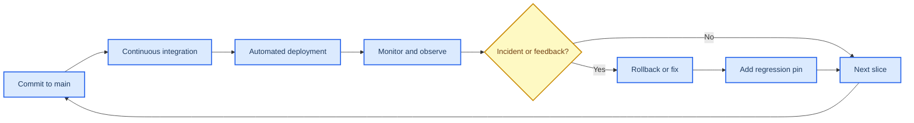

# DevOps

Purpose: shorten the path from commit to production with shared ownership, automation and continuous feedback.

## Definition and origin

DevOps is a set of practices and a cultural movement that combines development and operations responsibilities to deliver software faster and more reliably. Its technical core is continuous integration, continuous delivery, infrastructure as code, automated testing, monitoring and fast incident recovery. AWS and Microsoft describe it as a collaboration and process model rather than a single toolchain.

DevOps is not a project lifecycle on the same axis as Scrum or waterfall; it is the delivery pipeline and ownership model that can sit underneath any of them. It is included here because it changes how a slice reaches production.

## When it fits

- Releases are frequent enough that manual handoffs dominate lead time.
- The team can own both the code and its operational behaviour.
- Automated tests, builds and deployments are feasible.
- Reliability work can be scheduled as product work rather than an afterthought.

It is a poor fit when deployment is controlled by an external gate with long lead times, or when the organisation forbids developers access to production telemetry.

## How it works

1. **Continuous integration:** every commit builds and runs automated tests against a shared main branch.
2. **Continuous delivery/deployment:** package, promote and release through automated pipelines with consistent environments.
3. **Infrastructure as code:** define environments in versioned, reviewable configuration.
4. **Monitoring and observability:** instrument behaviour so production issues are diagnosable from evidence.
5. **Shared ownership:** the team that builds a capability helps operate it; blameless incident review feeds the backlog.
6. **Fast feedback loops:** use deployment frequency, lead time, change failure rate and recovery time to guide improvement.

## Strengths and failure modes

| Strength | Failure mode | Symptom / correction |
|---|---|---|
| Small changes reach users quickly | Pipeline as a separate team's responsibility | Developers wait for "the DevOps team"; give the product team ownership |
| Automation reduces release defects | Manual steps hidden in the pipeline | Flaky releases; automate and version each step |
| Production evidence informs the next slice | No telemetry on new capabilities | Incidents discovered by users; instrument the slice before release |
| Fast recovery limits blast radius | Rollback never rehearsed | Long outages; rehearse the rollback in the acceptance test |
| Shared ownership removes handoffs | "You build it, you own it" without support | Burnout; budget time for operational work |

## Mapping to vertical slices

- A slice is not done until it can be **deployed and observed**: the pipeline is part of the slice's touchpoints.
- Add the flag, metric and alert that let the slice be released, measured and rolled back in the same phase.
- A down-migration or feature-flag off is the slice's rollback; rehearsing it is part of the definition of done.
- Continuous integration prevents the integration cliff: each slice merges and is tested against everything already shipped.
- Incidents from a slice produce a regression pin and a re-ordered backlog item, not a separate "ops phase".

## Verification questions

1. Can the team deploy a single slice without a manual handoff?
2. Is the slice observable with a metric and an alert?
3. Was the rollback path rehearsed before release?
4. Did the last incident change the backlog or the definition of done?
5. Are operational tasks treated as product work with capacity?

## External References

| Source | What to consult it for | URL |
|--------|------------------------|-----|
| AWS — What is DevOps? | Definition, practices and the collaboration model | https://aws.amazon.com/devops/what-is-devops/ |
| Microsoft Azure — What is DevOps? | DevOps culture, practices and feedback loops | https://learn.microsoft.com/en-us/azure/devops/learn/what-is-devops |
| Wikipedia — DevOps (index only) | History, practices and relationship to agile | https://en.wikipedia.org/wiki/DevOps |
