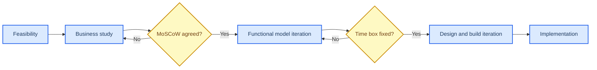

# DSDM

Purpose: use the Dynamic Systems Development Method's fixed time and cost with variable scope when governance requires a governed agile framework.

## Definition and origin

DSDM (Dynamic Systems Development Method) is an agile project delivery framework founded in 1994 by a UK consortium and now maintained by the Agile Business Consortium. Its defining rule is that **time and cost are fixed while scope is variable**. It provides roles, governance and a lifecycle — Feasibility, Business Study, Functional Model Iteration, Design and Build Iteration, Implementation — with explicit products for each.

DSDM is more formal than Scrum and is often chosen in government and regulated environments where an agile method must still satisfy audit and stage boundaries.

## When it fits

- A fixed budget and deadline exist but requirements are not fully fixed.
- Governance needs named roles, products and decision points.
- Scope can be prioritised with the MoSCoW technique (Must, Should, Could, Won't).
- Workshops with active user involvement are feasible.

It is a poor fit for small teams that find the role and product set excessive, or when scope truly cannot vary.

## How it works

1. **Feasibility and Business Study:** establish whether the project is viable and agree the business and technical scope.
2. **Functional Model Iteration:** iteratively define and test what the system must do, using workshops and prototypes.
3. **Design and Build Iteration:** iteratively design, build and test; integrate each increment.
4. **Implementation:** deploy, train and hand over.
5. **Apply the principles throughout:** active user involvement, empowered teams, frequent delivery, integrated testing, fitness for business purpose, incremental delivery, and quality built in.
6. **Prioritise with MoSCoW** and use time boxing so the deadline forces scope decisions.

## Strengths and failure modes

| Strength | Failure mode | Symptom / correction |
|---|---|---|
| Fixed time and cost fit governance | Everything labelled "Must" | No scope flexibility; enforce a cap on Must items |
| Active user involvement | Users attending without authority | Decisions deferred; require decision-makers in workshops |
| Formal products support audit | Product set becomes paperwork | Documents with no working software; accept a demo as the product evidence |
| MoSCoW gives a clear scope contract | Prioritisation done once | Stale priorities; re-prioritise at each iteration boundary |
| Integrated testing from the start | Testing deferred to implementation | Late defects; put tests in each iteration's definition of done |

## Mapping to vertical slices

- Each DSDM iteration delivers one or more **capability slices**; the iteration is a time box, not a technical stage.
- The Functional Model Iteration's prototypes should become the acceptance tests of real slices, not throwaway artefacts.
- MoSCoW priority applies to slices: a "Must" slice is one without which the release has no value.
- Fit the slice to the time box by narrowing capability; never extend the time box to fit the slice.
- The implementation phase is a release boundary, not a final test phase.

## Verification questions

1. Are time and cost fixed while scope is genuinely variable?
2. Is the Must set capped so trade-offs are possible?
3. Do user representatives have authority to decide?
4. Is each iteration producing a demoable capability rather than a model document?
5. Are tests integrated into every iteration?

## External References

| Source | What to consult it for | URL |
|--------|------------------------|-----|
| Agile Business Consortium — DSDM (official site) | The framework, principles, roles and current governance guidance | https://www.dsdm.org/ |
| Wikipedia — Dynamic systems development method (index only) | Lifecycle phases, MoSCoW prioritisation and history | https://en.wikipedia.org/wiki/Dynamic_systems_development_method |
| Agile Business Consortium (official site) | Organisation behind DSDM and related agile qualifications | https://www.agilebusiness.org/ |
| Wikipedia — Agile software development (index only) | DSDM's position among governed agile frameworks | https://en.wikipedia.org/wiki/Agile_software_development |
