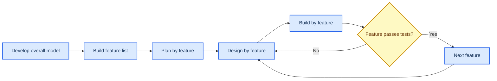

# Feature-Driven Development

Purpose: scale iterative delivery to larger teams by organising work around features and a shared domain model.

## Definition and origin

Feature-Driven Development (FDD) is an iterative, incremental agile method created by Jeff De Luca and Peter Coad in the 1990s. It is feature-centric: a feature is a small, client-valued function expressed as `<action> <result> <object>`, such as "calculate the total of a sale". FDD is famous for five activities and for a strict distinction between the progress of a feature (done or not) and percentage-complete estimates.

The National Academies report on DoD software acquisition describes FDD's origin during a troubled large project revived with iterative, incremental development and frequent end-user feedback. Wikipedia and the agile literature summarise the five activities and roles.

## When it fits

- Larger teams or multiple teams need a common structure without heavyweight ceremony.
- A domain model can be built and shared across features.
- The product can be decomposed into many small, client-valued features.
- Progress must be reported honestly as done or not done.

It is a poor fit for tiny projects, for domains where features are hard to isolate, or when no one can maintain the overall model.

## How it works

1. **Develop an overall model:** domain experts and the team agree the shape of the system.
2. **Build a features list:** enumerate client-valued functions and group them into feature sets.
3. **Plan by feature:** sequence features and assign feature sets to owners.
4. **Design by feature:** for each feature, pick the classes involved, write sequence diagrams and refine the design.
5. **Build by feature:** implement, test and integrate the feature; mark it complete only when it passes its tests.
6. **Track progress by completed features**, not by estimated percentages.

## Strengths and failure modes

| Strength | Failure mode | Symptom / correction |
|---|---|---|
| Client-valued features are easy to discuss | Feature list becomes an implementation task list | "Add repository layer"; use verb-result-object phrasing |
| Honest progress reporting | Percentage-complete inflation | Everything is 90% done; use binary done/not-done |
| Shared model coordinates teams | Model maintained by a separate architecture team | Model drifts from code; keep owners among builders |
| Scales beyond one small team | Feature sets split across layers | Team boundaries mirror components; assign features, not layers |
| Short design-build cycles per feature | Skipping the model step | Divergent interpretations; keep a lightweight shared model |

## Mapping to vertical slices

- An FDD feature **is** a vertical slice when it is small enough to ship independently: it crosses model, logic, data and UI.
- Group features into phases by capability and risk; do not create a phase per feature set owner.
- The feature's acceptance test is its completion criterion; "code written" does not count.
- Keep the shared model alive through the slices that touch it, with a named second consumer for any new abstraction.
- Use feature completion, not story-point velocity, as the roadmap's progress signal.

## Verification questions

1. Is each feature phrased as a client-valued function?
2. Is progress measured as binary completion rather than estimated percentage?
3. Does a feature cross every layer it needs before being marked done?
4. Who owns the overall model, and do builders keep it current?
5. Are teams assigned features rather than architectural components?

## External References

| Source | What to consult it for | URL |
|--------|------------------------|-----|
| Wikipedia — Feature-driven development (index only) | The five activities, feature format and roles | https://en.wikipedia.org/wiki/Feature-driven_development |
| National Research Council (2010), DoD software acquisition | Origin of FDD in an iterative rescue of a large project | https://www.nationalacademies.org/read/12823/chapter/5 |
| Wikipedia — Agile software development (index only) | FDD's place among agile methods and comparison with Scrum and XP | https://en.wikipedia.org/wiki/Agile_software_development |
| Agile Manifesto — Principles | Customer-valued working software as the measure of progress | https://agilemanifesto.org/principles.html |
