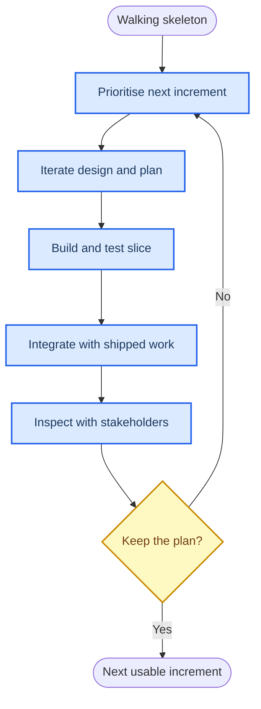

# Iterative and Incremental Development

Purpose: separate the two ideas behind short cycles — repeating the process and growing the product — and use both to shrink feedback loops.

## Definition and origin

**Iterative** means repeating the process: refine the plan, design and implementation across cycles. **Incremental** means growing the product: add a tested, usable piece to what already works. The combination is a principal alternative to single-pass sequential development and the foundation most agile frameworks share.

Its roots predate agile: PDSA at Bell Labs, Gilb's evolutionary project management, NASA Project Mercury's time-boxed half-day iterations, and Royce's recommendation to "do the job twice." The National Academies traces these threads and notes that iterative and incremental development (IID) was used successfully on large defence systems long before the term agile existed.

## When it fits

- Requirements cannot be fully specified up front but every increment must remain usable.
- Integration risk is real and should be retired early rather than at the end.
- Stakeholders can react to working software between cycles.
- The domain allows frequent releases, or at least frequent demonstrable increments.

It is less useful when the interface is frozen by an external authority and the work is genuinely repeatable, or when an increment cannot be made usable without the rest of the system.

## How it works

1. **Establish a baseline** that already runs end to end — a walking skeleton or thinnest slice.
2. **Prioritise the next increment** by risk and value, not by layer.
3. **Iterate within the increment:** refine the design and plan as evidence arrives.
4. **Build, test and integrate** the increment with everything shipped before it.
5. **Inspect the result with stakeholders** and adjust the ordering for the next cycle.
6. **Keep every increment usable and additive**; a increment that only "sets up" the next one is not an increment.

Delivery cadence and iteration cadence are separate choices. A six-week increment can contain weekly iterations; a daily deployment can still be one increment.

## Strengths and failure modes

| Strength | Failure mode | Symptom / correction |
|---|---|---|
| Early integration exposes interface risk | Mini-waterfall inside each cycle | Design cycle, build cycle, test cycle; ship one slice per cycle |
| Feedback changes the plan while changes are cheap | Iteration without increment | Repeated redesign, nothing usable; require a running increment each cycle |
| Risks are retired in priority order | Risk deferred to "later cycles" | The last 20% takes 60% of the time; order by risk, not comfort |
| Progress is demonstrable | Perpetual prototype | Working code that never hardens; each increment gets a definition of done |
| Aligns naturally with vertical slices | Increments that are architectural layers | "Database increment", "UI increment"; cut by capability |

## Mapping to vertical slices

- An increment **is** a vertical slice: an actor can do something new when it ships.
- Iteration is the internal refinement of that slice; if the slice needs a whole cycle just to become demoable, narrow it.
- Order increments by risk and dependency; fold pure prerequisites into the slice they block.
- Every increment must integrate with all previous ones and keep a rollback path — that is what makes the product additive rather than a pile of branches.
- Use the iteration boundary to re-order the roadmap; re-ordering is discovery, not a missed deadline.

## Verification questions

1. Can a user do something new after this increment, or did you only refine the design?
2. Is the increment integrated with everything shipped before it?
3. Are iteration and increment lengths chosen independently and deliberately?
4. Did stakeholder feedback change the next increment's priority?
5. Does each increment remain usable and revertible?

## External References

| Source | What to consult it for | URL |
|--------|------------------------|-----|
| Wikipedia — Iterative and incremental development (index only) | Definitions, history and distinction between iteration and increment | https://en.wikipedia.org/wiki/Iterative_and_incremental_development |
| National Research Council (2010), DoD software acquisition | History of IID, project examples, and why increments need real user feedback | https://www.nationalacademies.org/read/12823/chapter/5 |
| The Scrum Guide (2020, official HTML) | An Increment as an additive, usable stepping stone with a Definition of Done | https://scrumguides.org/scrum-guide.html |
| Agile Manifesto — Principles | Early and continuous delivery, with a preference for shorter timescales | https://agilemanifesto.org/principles.html |
