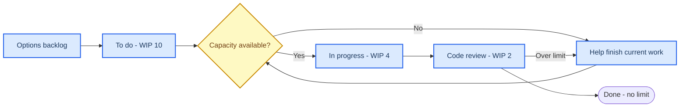

# Kanban

Purpose: manage flow with explicit policies and WIP limits when work arrives continuously and priorities change between items.

## Definition and origin

Kanban is a management method for knowledge work, founded in Lean manufacturing and formalised by David J. Anderson's 2010 book. Kanban University, the home of the method, is explicit that Kanban is neither a methodology nor a process framework: it is applied on top of the way of working you already have. Its six general practices are visualise, limit work in progress, manage flow, make policies explicit, implement feedback loops, and improve collaboratively and evolve experimentally.

Kanban and Scrum are the two dominant agile families but solve different problems: Scrum offers cadence through time-boxes; Kanban offers responsiveness through flow control.

## When it fits

- Requests arrive continuously and cannot be batched into a sprint goal.
- Priorities change as work moves through the system.
- The team can finish before starting and respect explicit WIP limits.
- Lead time and throughput matter more than a fixed review date.

It fits less well when nothing forces a demo, when work is invisible, or when nobody owns the ordering of the next item.

## How it works

1. **Visualise the workflow** with columns that model how work actually moves, not an idealised sequence.
2. **Set WIP limits** per column, person or class of service; when a limit is hit, help finish work before pulling more.
3. **Make policies explicit:** replenishment criteria, pull criteria, WIP limits, classes of service, meeting cadences.
4. **Manage flow** with lead time, delivery rate and cumulative flow diagrams; swarm blockers.
5. **Implement feedback loops** through the board, metrics and cadences such as replenishment and delivery planning.
6. **Improve experimentally:** propose safe-to-fail changes, collect data, keep or roll back.
7. **Keep a commitment point and a delivery point** on every board; before commitment, ideas are options, not scheduled work.

## Strengths and failure modes

| Strength | Failure mode | Symptom / correction |
|---|---|---|
| Responds to interrupts without breaking a sprint | No forcing function for a demo | Work drifts; put demo in the definition of done for each capability |
| WIP limits expose bottlenecks | Limits raised whenever hit | "Debt ceiling"; fix the bottleneck or the item size instead |
| Flow metrics make delays visible | Too many metrics | Dashboard theatre; start with lead time, throughput and WIP |
| Policies make decisions faster | Implicit rules | New members guess; write sparse, visible, agreed policies |
| Evolutionary change is low risk | Big-bang transformation | Failed rollout; start with what you do now and change one thing |

## Mapping to vertical slices

- Phase boundaries become **release or stakeholder-decision milestones**; the rest is a capability list with states and lead times.
- Put the slice's acceptance test in its pull criteria: a card is not Done until the capability is demoable.
- WIP limits apply to slices, not to technical layers; a column of "database work" is a layer queue.
- Use cycle time to check whether slices are right-sized; a long-lived card is usually a slice that was too large.
- Re-prioritise between items, not inside a slice; the slice's capability stays stable while its order may change.

## Verification questions

1. Does the board show actual workflow states, including review and approval queues?
2. Are WIP limits based on observed averages and respected when hit?
3. Can the team name what is demoable for each Done capability?
4. Do pull criteria include a test and a rollback path?
5. Did the last improvement come from data rather than opinion?

## External References

| Source | What to consult it for | URL |
|--------|------------------------|-----|
| Kanban University — The Official Guide to the Kanban Method | Principles, six general practices, WIP limits, metrics and glossary | https://kanban.university/kanban-guide/ |
| Atlassian — Kanban vs. Scrum | Comparison of flow and sprint models, metrics and selection criteria | https://www.atlassian.com/agile/kanban/kanban-vs-scrum |
| Atlassian — WIP limits | Starting numbers, anti-patterns and item-size guidance | https://www.atlassian.com/agile/kanban/wip-limits |
| David J. Anderson — Driving Evolutionary Change | WIP limit as a stressor and reflection mechanism by maturity level | https://djaa.com/driving-evolutionary-change-with-the-kanban-method/ |
| Wikipedia — Kanban (development) (index only) | Origins in lean manufacturing and adoption in software | https://en.wikipedia.org/wiki/Kanban_(development) |
