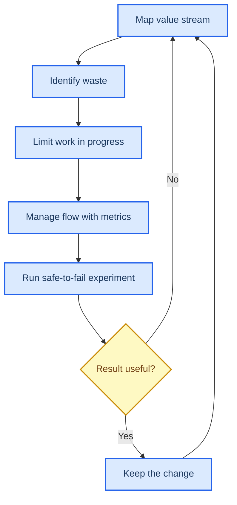

# Lean Software Development

Purpose: apply lean thinking — eliminate waste, amplify learning, decide late, deliver fast — to shorten the path from idea to working software.

## Definition and origin

Lean software development adapts principles from lean manufacturing to knowledge work, notably in the book by Mary and Tom Poppendieck. The seven principles are commonly stated as eliminate waste, amplify learning, decide as late as possible, deliver as fast as possible, empower the team, build integrity in, and see the whole. Kanban University explicitly traces the Kanban Method's roots to Lean, including flow, limiting WIP, systems thinking and evolutionary improvement.

Lean is a way of thinking rather than a fixed set of ceremonies; it underpins Kanban and influences XP and Shape Up.

## When it fits

- Queues, handoffs and partially finished work are the dominant source of delay.
- The cost of a wrong decision can be reduced by deciding later with more information.
- Teams can be trusted to improve their own system.
- Fast feedback matters more than a fixed plan.

It is a poor fit when external compliance requires early, frozen decisions, or when the organisation cannot tolerate local autonomy.

## How it works

1. **Map the value stream** and identify waste: waiting, handoffs, defects, unused features, context switching.
2. **Limit work in progress** so flow replaces utilisation; make bottlenecks visible.
3. **Amplify learning** with short feedback loops, experiments and fast tests.
4. **Delay commitment** to the last responsible moment: keep options open until evidence resolves them.
5. **Deliver fast** in small batches; speed is a way to get feedback, not a performance metric.
6. **Empower the team** with explicit policies and boundaries rather than instructions.
7. **Build integrity in** with tests, continuous integration and attention to total system quality.
8. **See the whole:** optimise the system, not individual roles or metrics.

## Strengths and failure modes

| Strength | Failure mode | Symptom / correction |
|---|---|---|
| Small batches shorten lead time | Optimising local speed | One team fast, product slow; measure end-to-end lead time |
| Late decisions use better information | Indefinite postponement | Nothing decided; use "last responsible moment" with a deadline |
| Waste is named and removed | Cutting quality work as "waste" | Tests and documentation removed; distinguish waste from necessary quality |
| Empowered teams improve continuously | Autonomy without alignment | Local optima; give explicit policies and shared goals |
| Flow metrics expose delay | Team as a resource to maximise | 100% utilisation and poor flow; leave slack in the system |

## Mapping to vertical slices

- A slice is a small batch: one capability, end to end, with a test and a rollback.
- Delay irreversible design decisions to the slice that first needs them, but decide foundational constraints early enough to avoid rework.
- Limit WIP at the slice level; finishing beats starting another partial capability.
- Treat stubbed or half-built layers as waste: they cannot give feedback.
- Use lead time per slice as a sizing signal; a slow slice is usually too large or waiting on a dependency.

## Verification questions

1. Which waste is visible in your current slice flow?
2. Is WIP limited at the capability level, or only at the task level?
3. Which decision are you delaying, and what evidence will resolve it?
4. Does the team have authority to change its process within agreed boundaries?
5. Did you optimise end-to-end lead time rather than a local metric?

## External References

| Source | What to consult it for | URL |
|--------|------------------------|-----|
| Atlassian — What is Lean Methodology? | Lean principles, flow focus and waste reduction in knowledge work | https://www.atlassian.com/agile/project-management/lean-methodology |
| Wikipedia — Lean software development (index only) | Seven lean principles and their origin in manufacturing | https://en.wikipedia.org/wiki/Lean_software_development |
| Kanban University — The Official Guide to the Kanban Method | Lean roots, WIP limits, pull systems and evolutionary improvement | https://kanban.university/kanban-guide/ |
| Agile Manifesto — Principles | Simplicity, sustainable pace and frequent working software | https://agilemanifesto.org/principles.html |
