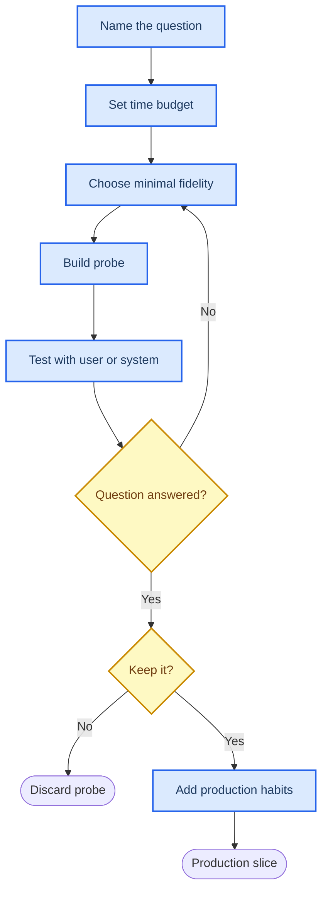

# Prototyping

Purpose: distinguish throwaway and evolutionary prototypes, and use each to retire a specific risk without confusing a demonstration with a shipped capability.

## Definition and origin

A prototype is an incomplete, early version of a system or part of it, built to learn rather than to deliver final functionality. The key split is **throwaway** (explore a question, then discard) versus **evolutionary** (refine the prototype into the product). A third useful distinction is with a **walking skeleton**: a prototype may use stubs and need not survive; a walking skeleton is production code that connects the real components.

Prototyping appears inside several lifecycles. Boehm's spiral uses prototypes to resolve risk, the National Academies report describes Royce's pilot model and later evolutionary prototyping, and the V-model literature uses executable models as testable prototypes.

## When it fits

- A question can only be answered by seeing or using something: UI flow, latency, hardware interface, data shape.
- The cost of answering by building the real thing is higher than the cost of a probe.
- Stakeholders cannot specify what they want until they react to an artefact.
- The risk is reversible and bounded by an appetite (time budget).

Avoid prototyping when the answer is already known, when the prototype will be shown to users as if it were the product, or when its shortcuts will be carried into production unnoticed.

## How it works

1. **Name the question** the prototype must answer and the decision it will support.
2. **Set the appetite:** how much time the answer is worth, with a hard cap.
3. **Choose the fidelity** needed: paper screens for flow, a fake endpoint for integration, real data for performance.
4. **Build the smallest artefact** that exercises the risky boundary.
5. **Test it with the intended user or system**, capture evidence and a decision.
6. **Decide its fate explicitly:** discard it, or promote it with production habits — tests, monitoring, error handling, security.
7. **Record the learning** in the next slice's acceptance criteria.

Throwaway prototypes are disposable; evolutionary prototypes are not exempt from quality work just because they started as sketches.

## Strengths and failure modes

| Strength | Failure mode | Symptom / correction |
|---|---|---|
| Answers expensive questions cheaply | Prototype becomes the product by accident | Production runs on stub code; decide fate at the outset |
| Users react to something concrete | False expectations | Stakeholders treat a demo as a commitment; label it and keep the appetite visible |
| Retires interface and usability risk early | Endless polishing | The probe never ends; time-box it and require a decision |
| Supports spiral and V-model risk work | Ignoring non-functional concerns | "It worked on the laptop"; prototype the risky constraint, not only the happy screen |
| Cheap to change before commitment | Sunk-cost escalation | Team defends the prototype because of effort spent; discard when the question is answered |

## Mapping to vertical slices

- A prototype is **not** a slice: it does not have to survive a restart, be reversible, or enforce real rules.
- Use a prototype before the slice that carries the risk; the slice is the production answer, the prototype is the question.
- The prototype's evidence becomes the slice's acceptance test or its chosen design approach.
- For a prototype that will be promoted, add the missing touchpoints (persistence, auth, error handling, observability) in the slice, not later.
- In prototype-scoped roadmaps, one or two short probes plus a walking skeleton is enough; do not build a roadmap around artefacts that will be thrown away.

## Verification questions

1. What question does this prototype answer, and what decision follows from the answer?
2. Is it throwaway or evolutionary, and is that decision recorded?
3. Does its fidelity match the risk, or is it over- and under-built in the wrong places?
4. If it will be promoted, what production habits are still missing?
5. Did the learning change a slice's acceptance criteria or ordering?

## External References

| Source | What to consult it for | URL |
|--------|------------------------|-----|
| Wikipedia — Software prototyping (index only) | Types of prototypes, throwaway versus evolutionary, and prototyping methods | https://en.wikipedia.org/wiki/Software_prototyping |
| Wikipedia — Prototype (index only) | General distinction between a prototype, a pilot and a sample | https://en.wikipedia.org/wiki/Prototyping |
| National Research Council (2010), DoD software acquisition | Royce's pilot model and evolutionary prototyping as risk-reduction | https://www.nationalacademies.org/read/12823/chapter/5 |
| Kieran Potts — Walking skeleton | Why a walking skeleton is production code, unlike a spike or prototype | https://kieranpotts.com/garden/walking-skeleton.html |
