# Rapid Application Development

Purpose: use time-boxed, user-in-the-loop development when requirements can be discovered quickly and the product can be modularised.

## Definition and origin

Rapid Application Development (RAD) is an adaptive, plan-light approach that favours short time boxes, heavy user involvement, iterative prototyping, and reusable components over detailed up-front specification. It is associated with James Martin's 1990s method and with joint application design (JAD) workshops, in which users and developers specify and review requirements together.

RAD is a response to the slow handoffs of plan-driven development: rather than documenting requirements and waiting, it builds working systems in increments and lets users correct them while changes are cheap.

## When it fits

- Requirements are not fully known but key users are available to collaborate continuously.
- The system can be decomposed into modules that different teams can build in parallel.
- The domain supports iterative refinement and a usable system within a few months.
- Tooling or frameworks allow rapid construction and reuse.

It is a poor fit when stakeholders cannot participate, when the system cannot be modularised, or when correctness depends on a frozen formal specification.

## How it works

1. **Requirements planning with JAD:** facilitated workshops produce a shared, prioritised requirement set.
2. **User design:** users and developers refine prototypes and design together in short cycles.
3. **Construction:** teams build modules in parallel using reusable components; integration is continuous.
4. **Cutover:** deploy the increment, train users, and move to the next time box.
5. **Keep time boxes fixed** and vary scope, not the deadline.

The RAD emphasis on user workshops and parallel module construction is why it can produce a usable system quickly, and why it can degenerate into unsupported prototypes if construction is not disciplined.

```mermaid
flowchart LR
    accTitle: RAD Time-boxed Delivery
    accDescr: JAD workshops feed modular parallel construction inside a fixed time box, ending in cutover and the next time box.

    jad[JAD workshop] --> feature_list[Prioritised feature list]
    feature_list --> timebox[Fixed time box]
    timebox --> parallel[Parallel module teams]
    parallel --> integrate[Integrate modules]
    integrate --> cutover[Cutover and training]
    cutover --> scope_left{Scope left?}
    scope_left -->|Yes| timebox
    scope_left -->|No| release([Release complete])

    classDef process fill:#dbeafe,stroke:#2563eb,stroke-width:2px,color:#1e3a5f
    classDef decision fill:#fef9c3,stroke:#ca8a04,stroke-width:2px,color:#713f12
    class jad,feature_list,timebox,parallel,integrate,cutover process
    class scope_left decision
```

## Strengths and failure modes

| Strength | Failure mode | Symptom / correction |
|---|---|---|
| Fast delivery of usable systems | Skipping design discipline | Fragile code that cannot evolve; keep explicit construction standards |
| Continuous user involvement catches misunderstanding | Unavailable users | Workshops happen without decision-makers; require authority in the room |
| Parallel module work shortens the schedule | Integration cliff at cutover | Modules meet for the first time late; integrate each module as it is built |
| Reusable components reduce repeated work | Over-engineered shared framework | Time spent building infrastructure instead of behaviour; reuse only with a second consumer |
| Fixed time boxes force scope decisions | Perpetual prototyping | A demo that is never production-ready; give every increment a definition of done |

## Mapping to vertical slices

- A RAD time box maps to one or more **capability slices**, never to a technical layer.
- JAD workshops are the input to the capability list; leave with verbs and objects, not a feature-by-module matrix.
- Parallel module teams should own different slices, not different layers of the same unfinished slice.
- Hold the time box and narrow the slice when it does not fit — this is the same rule as in Scrum.
- Reuse is justified by a second slice, not by an anticipated future need.

## Verification questions

1. Are the people in the workshop able to make requirement decisions?
2. Does each time box end with a usable capability rather than a prototype?
3. Are parallel teams separated by capability or by layer?
4. Is integration happening continuously rather than at cutover?
5. Did the fixed deadline force explicit scope decisions?

## External References

| Source | What to consult it for | URL |
|--------|------------------------|-----|
| Wikipedia — Rapid application development (index only) | RAD phases, time boxes, user involvement and criticism | https://en.wikipedia.org/wiki/Rapid_application_development |
| Wikipedia — Joint application design (index only) | JAD workshops, participants and outcomes | https://en.wikipedia.org/wiki/Joint_application_development |
| Wikipedia — Software prototyping (index only) | Prototyping techniques RAD relies on and their limits | https://en.wikipedia.org/wiki/Software_prototyping |
| Agile Manifesto — Principles | Customer collaboration daily and frequent delivery of working software | https://agilemanifesto.org/principles.html |
