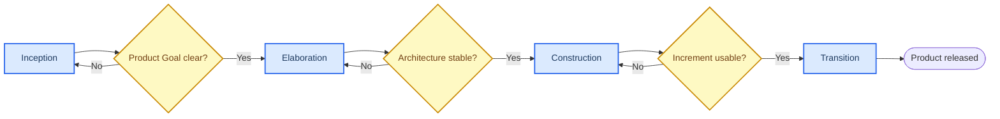

# Rational Unified Process

Purpose: understand the iterative, use-case-driven, architecture-centric framework and where its phase boundaries can host vertical slices.

## Definition and origin

The Rational Unified Process (RUP) is a software development framework from Rational Software, published in the 1990s and documented in a well-known book by Kruchten and others. It is iterative and incremental, use-case driven, architecture centric, and risk focused. It is often mistaken for a heavyweight waterfall recipe; its four phases — Inception, Elaboration, Construction, Transition — each end in a milestone and may contain multiple iterations.

RUP's milestones align with Boehm's spiral anchor points: Life Cycle Objective at the end of Inception, Life Cycle Architecture at the end of Elaboration, and Initial Operational Capability at the end of Construction.

## When it fits

- Large systems where architecture decisions dominate later cost.
- Teams that need explicit roles, artifacts and milestones for governance or contract reasons.
- Domains with significant risk that must be retired before broad construction.
- Projects already using UML or model-driven tooling.

It is a poor fit for small products where the artifact set outweighs the work, or where the organisation cannot tailor the framework.

## How it works

1. **Inception:** establish scope, vision, business case and a rough architecture; exit at Life Cycle Objective.
2. **Elaboration:** refine the architecture, retire the highest risks, build an architectural prototype; exit at Life Cycle Architecture.
3. **Construction:** build the product in iterations, integrate and test continuously; exit at Initial Operational Capability.
4. **Transition:** deploy, train, stabilise and hand over to operations.
5. **Across all phases:** disciplines (requirements, analysis and design, implementation, test, deployment) run concurrently with different emphasis per phase — not as sequential handoffs.
6. **Tailor the process:** RUP is a framework, not a fixed process; select the artifacts and iterations the project needs.

## Strengths and failure modes

| Strength | Failure mode | Symptom / correction |
|---|---|---|
| Architecture risk is retired early | "Elaboration" becomes document production | No running architecture; require an executable skeleton |
| Use cases connect requirements to tests and design | Use cases treated as documents only | Traceability without behaviour; attach acceptance tests |
| Explicit milestones support governance | Ceremony without decisions | Milestones passed regardless of evidence; require objective exit criteria |
| Iterations inside phases keep feedback short | Phase names used as layer phases | "Requirements phase", "design phase"; name phases by capability |
| Tailorable to project size | Tailoring skipped | Hundreds of templates for a small team; cut artifacts aggressively |

## Mapping to vertical slices

- RUP phases become **roadmap phases**; each phase contains capability slices, not layer work.
- The architectural prototype in Elaboration should be a **walking skeleton**: a real thin slice through all layers.
- Use-case-driven development maps naturally to capability lists and acceptance tests: one use case or scenario per slice.
- Milestone evidence comes from slice tests and demos, not from document counts.
- In Construction, size slices to one iteration and order them by risk; Transition is a release activity, not a final test phase.

## Verification questions

1. Does each phase exit on evidence of working behaviour, or on document completion?
2. Is the architecture realised in a running skeleton before broad construction?
3. Are disciplines concurrent within iterations rather than sequential handoffs?
4. Which RUP artifacts did you tailor away, and why?
5. Do phase names describe capabilities or framework stages?

## External References

| Source | What to consult it for | URL |
|--------|------------------------|-----|
| Wikipedia — Rational unified process (index only) | Four phases, milestones, disciplines and criticisms | https://en.wikipedia.org/wiki/Rational_Unified_Process |
| Wikipedia — Unified process (index only) | RUP as a unified-process framework and its tailoring | https://en.wikipedia.org/wiki/Unified_process |
| Wikipedia — Spiral model (index only) | Mapping of spiral anchor milestones onto RUP phase boundaries | https://en.wikipedia.org/wiki/Spiral_model |
| Wikipedia — Iterative and incremental development (index only) | RUP's place in the iterative-incremental family | https://en.wikipedia.org/wiki/Iterative_and_incremental_development |
