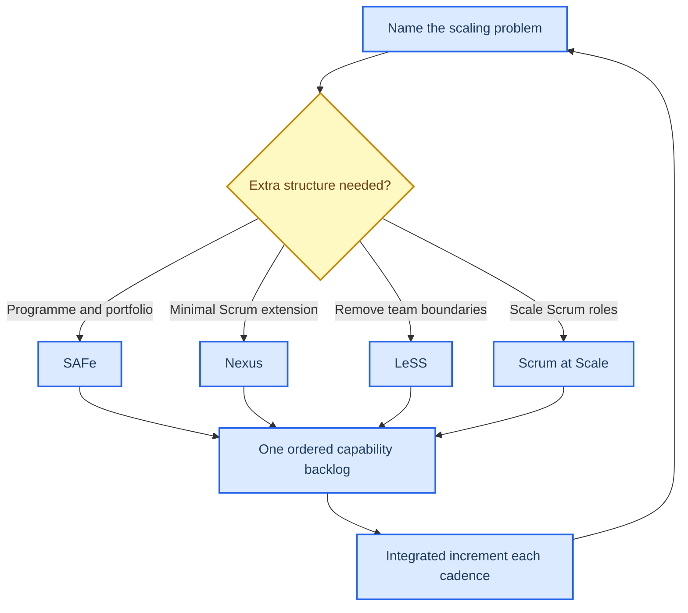

# Scaled Agile

Purpose: choose among SAFe, LeSS, Nexus and Scrum@Scale when several teams must deliver one product together.

## Definition and origin

Scaled agile frameworks coordinate multiple teams while keeping agile principles. They differ in how much structure they add:

- **SAFe (Scaled Agile Framework)** is the most prescriptive, with team, program and portfolio levels and a formal training and certification ecosystem.
- **LeSS (Large-Scale Scrum)** keeps Scrum intact and removes organisational boundaries; one Product Backlog and one Product Owner for many teams.
- **Nexus** is a Scrum.org extension that adds a Nexus Framework for three to nine Scrum Teams with a single Product Backlog and an Integration Team.
- **Scrum@Scale**, created by Jeff Sutherland, scales Scrum through a Scrum Master Pyramid and MetaScrum, applying the same roles at higher levels.

Each is a distinct answer to the same question: how do many teams stay aligned without reintroducing layer-based work?

## When it fits

- Several teams work on one product and share an architecture or a release train.
- Dependencies cross teams often enough that local planning alone fails.
- Stakeholders need a single ordered backlog and a common cadence.
- An organisation needs a migration path from existing governance.

It is a poor fit for one or two co-located teams: the coordination overhead outweighs the benefit. Choose the least prescriptive framework that solves the actual dependency problem.

## How it works

1. **Name the scaling problem:** shared backlog, shared architecture, release coordination or portfolio funding.
2. **Pick a framework** that addresses it with the least extra structure.
3. **Keep one ordered backlog** where possible; teams pull capability slices, not layers.
4. **Establish a common cadence** for integration and review, with explicit dependency handling.
5. **Make integration continuous:** each slice must work with everything shipped by other teams.
6. **Keep teams cross-functional and self-managing**; scaling must not turn them into component teams.
7. **Review the scaling itself** at each cadence: remove coordination that no longer earns its cost.

## Strengths and failure modes

| Strength | Failure mode | Symptom / correction |
|---|---|---|
| Shared priorities across teams | Framework adopted for its name | Heavy ceremonies, no dependency reduction; start from the problem |
| Common cadence makes integration predictable | Sync meetings without integration | Teams align on dates but not code; integrate continuously |
| Single backlog prevents duplicate work | Backlog split by component | Each team owns a layer; order by capability across teams |
| Explicit frameworks ease governance | "Scrum at scale" that is not Scrum | No single usable Increment; restore the Scrum definition of done |
| Scaling roles support coordination | Coordination layer becomes a management hierarchy | Decisions slow; keep teams self-managing |

## Mapping to vertical slices

- A scaled phase is a **release or program increment** containing capability slices from several teams.
- Teams own capabilities, not layers; a team that owns "the database" cannot deliver a slice.
- Slice size is bounded by the team's iteration even when the programme cadence is longer.
- Integration evidence belongs in the slice's acceptance test: a slice is not done until it works with other teams' increments.
- Keep a shared definition of done across teams; otherwise "done" means different things at each handoff.

## Verification questions

1. Which scaling problem are you actually solving?
2. Is there one ordered backlog of capabilities, or several component backlogs?
3. Do teams own capabilities or technical layers?
4. Does the common cadence produce integrated working software?
5. Can you name a coordination ceremony you removed because it stopped helping?

## External References

| Source | What to consult it for | URL |
|--------|------------------------|-----|
| Scaled Agile Framework — official site | SAFe levels, roles and programme structure | https://scaledagileframework.com/ |
| LeSS — official site | Large-Scale Scrum principles, one backlog and organisational design | https://less.works/ |
| Scrum.org — Online Nexus Guide (official) | Nexus definition, integration team, single backlog and Integrated Increment | https://www.scrum.org/resources/online-nexus-guide |
| Scrum@Scale — official site | Scrum Master Pyramid and scaling by applying Scrum to Scrum | https://www.scrumatscale.com/ |
