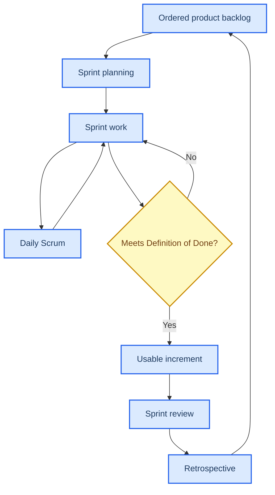

# Scrum

Purpose: use fixed-length sprints and a shared increment to create a predictable cadence for delivering and inspecting capability slices.

## Definition and origin

Scrum is a lightweight framework for complex problems, defined solely by the Scrum Guide written by Ken Schwaber and Jeff Sutherland. It is empirical: transparency, inspection and adaptation are its pillars, and it is built on iterative and incremental development. A Scrum Team is small, cross-functional and self-managing, with accountabilities for Developers, Product Owner and Scrum Master.

Scrum deliberately leaves out engineering practices; it is a container for them. Agile Alliance and Atlassian add practical interpretation, while the Scrum Guide remains the normative source.

## When it fits

- A stable team can commit to a sprint goal and finish selected work inside the sprint.
- A Product Owner can order a backlog by value.
- Stakeholders can inspect a usable increment at a regular review.
- Interruptions are rare enough that a frozen sprint goal is meaningful.

It fits less well when urgent work repeatedly breaks the sprint goal, when items cannot be finished in one sprint, or when no one can order the backlog. Consider Kanban in those cases.

## How it works

1. **Sprint:** a fixed event of one month or less; a new one starts immediately after the previous one ends.
2. **Sprint Planning:** agree why the sprint is valuable (Sprint Goal), what can be done, and how it will be done; decompose items to a day or less.
3. **Daily Scrum:** a 15-minute inspection of progress toward the Sprint Goal, with an actionable plan for the next day.
4. **Sprint Review:** inspect the Increment with stakeholders and adjust the Product Backlog.
5. **Sprint Retrospective:** inspect the team's process and define the most impactful improvement.
6. **Artifacts and commitments:** Product Backlog (Product Goal), Sprint Backlog (Sprint Goal), Increment (Definition of Done).
7. **Quality does not decrease** inside a sprint; scope may be clarified and renegotiated with the Product Owner without endangering the goal.

## Strengths and failure modes

| Strength | Failure mode | Symptom / correction |
|---|---|---|
| Predictable cadence for review and adaptation | Sprint as mini-waterfall | Design sprint, build sprint, test sprint; ship one slice per sprint |
| Sprint Goal protects focus | Sprint in name only | No demoable outcome; narrow the slice until one sprint fits it |
| Empirical control of risk | Velocity as productivity score | Cross-team comparisons; use velocity only as local planning input |
| Definition of Done makes quality explicit | Done means "merged" | Items cannot be released; make DoD checkable: tested, reviewed, deployable, revertible |
| Retrospectives improve the process | Ceremony without change | Same issue every retro; act on one improvement per iteration |

## Mapping to vertical slices

- A phase becomes a milestone containing several sprints that share one demoable outcome.
- Each sprint completes at least one slice, or a demoable narrowing of one; the slice crosses all layers.
- Slice size is bounded by the sprint: if it does not fit, narrow the capability, not the sprint.
- Sprint Review is the demo for the phase's acceptance test; Sprint Backlog tasks are grouped under slices, not layers.
- Rollback and Definition of Done are checked before an item counts toward the Increment.

## Verification questions

1. What is the Sprint Goal, and is it still valid?
2. Can the team name something demoable at the end of this sprint?
3. Does every Done item meet a checkable Definition of Done?
4. Did the review change the Product Backlog order?
5. Did the retrospective produce one change the team actually tried?

## External References

| Source | What to consult it for | URL |
|--------|------------------------|-----|
| The Scrum Guide (2020, official HTML) | Normative definitions of events, artifacts, accountabilities and DoD | https://scrumguides.org/scrum-guide.html |
| Scrum.org — Definition of Done learning series | DoD as the quality commitment of the Increment | https://www.scrum.org/learning-series/definition-done/ |
| Atlassian — What is Scrum? | Practical explanation of roles, artifacts and ceremonies | https://www.atlassian.com/agile/scrum |
| Wikipedia — Scrum (index only) | History of the framework and wider adoption | https://en.wikipedia.org/wiki/Scrum_(software_development) |
