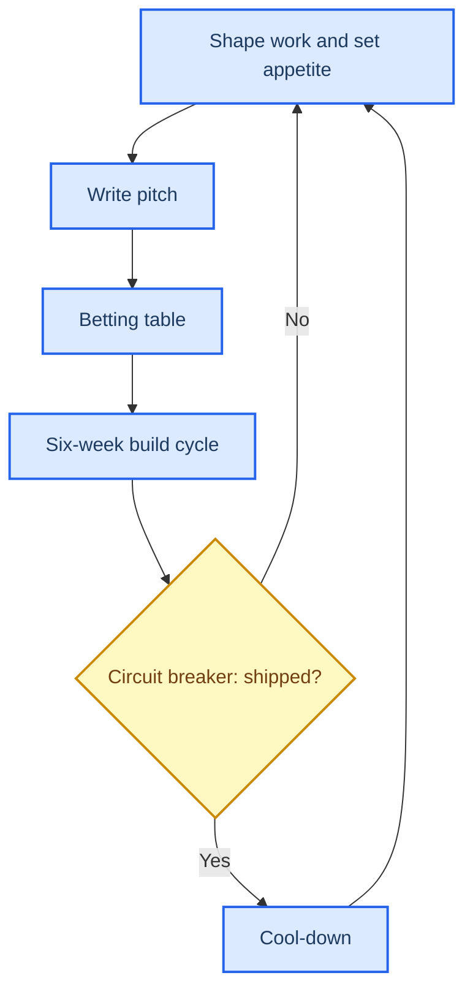

# Shape Up

Purpose: shape work before committing to it, then bet on fixed-time, variable-scope cycles so teams ship whole capabilities without a backlog treadmill.

## Definition and origin

Shape Up is Basecamp's product development method, published as a free book by Ryan Singer. It replaces estimates with **appetites** (how much time an idea is worth), backlogs with a **betting table**, and two-week sprints with **six-week cycles** followed by two weeks of cool-down. Small senior groups shape work in parallel with delivery teams; teams then own whole projects and build vertical slices one at a time.

The method's circuit breaker is deliberate: if a project does not ship within its bet, it is not automatically extended — the shaping was wrong, and the idea is reconsidered.

## When it fits

- Product teams can work in six-week batches with no interruptions.
- Work can be shaped ahead of time by senior people who understand the domain.
- A hard deadline is useful to force scope decisions.
- The organisation can tolerate not having a prioritised backlog of everything.

It is a poor fit for support or operations work with continuous interrupts, for very small changes that do not justify shaping, or where stakeholders require a documented queue of all future work.

## How it works

1. **Shape the work:** set boundaries, define the appetite, solve the rabbit holes, and write a pitch with a defined payout.
2. **Bet at the betting table:** during cool-down, decision makers choose which shaped pitches get a cycle. Only one cycle ahead is bet.
3. **Build in a six-week cycle:** a small integrated team of designers and programmers defines its own tasks, makes scope trade-offs and ships vertical slices.
4. **Protect uninterrupted time:** no pulling people away for "just an hour"; momentum is a second-order effect.
5. **Apply the circuit breaker:** no automatic extension; if the bet fails, re-shape rather than spend multiples of the time.
6. **Cool down for two weeks:** recover, explore and prepare the next pitches.

## Strengths and failure modes

| Strength | Failure mode | Symptom / correction |
|---|---|---|
| Appetite replaces estimate theatre | Appetite treated as an estimate | Debate about "how long"; ask "how much is it worth?" |
| Shaped work removes rabbit holes | Over-shaped pitch with no room to decide | Team becomes ticket-takers; leave abstraction for implementation decisions |
| Six weeks fits a whole capability | Two-week habits inside a six-week box | Sprint planning overhead; plan the cycle, not the day |
| Circuit breaker stops runaway projects | Deadline used as an excuse for poor quality | Rushed shipping; keep the quality bar in the definition of done |
| No backlog to groom | Losing good ideas | Pitches discarded forever; advocates can re-pitch later independently |

## Mapping to vertical slices

- Shape Up already builds "vertical slices of the product one at a time" — this skill and the method share the same unit of delivery.
- The pitch's payout is the slice's demoable outcome; the acceptance test should be part of the pitch.
- Appetite bounds slice size: if the capability cannot fit the bet, narrow the problem definition or break off a meaningful part.
- The circuit breaker is a rollback alternative: when time runs out, cut scope rather than ship a half-working slice.
- Cool-down is the natural place to record learning and re-order the next cycle's slices.

## Verification questions

1. Was the work shaped before the team was asked to build it?
2. Is the appetite a time budget, not a disguised estimate?
3. Does the pitch define a payout a user can see?
4. Is the team protected from interruption for the whole cycle?
5. Did the last unfinished bet lead to re-shaping rather than an extension?

## External References

| Source | What to consult it for | URL |
|--------|------------------------|-----|
| Basecamp — Shape Up (official free book) | The method's principles, shaping, appetite and cycle structure | https://basecamp.com/shapeup |
| Shape Up — Introduction (official, chapter 1) | Six-week cycles, shaping, autonomous teams and vertical slices | https://basecamp.com/shapeup/0.3-chapter-01 |
| Shape Up — Bets, Not Backlogs (official, chapter 7) | Betting table, no backlog and keeping options open | https://basecamp.com/shapeup/2.1-chapter-07 |
| Shape Up — The Betting Table (official, chapter 8) | Cycle length, cool-down, team sizes and the circuit breaker | https://basecamp.com/shapeup/2.2-chapter-08 |
