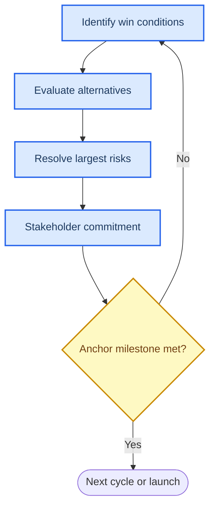

# Spiral Model

Purpose: use Boehm's risk-driven lifecycle when the main uncertainty is not scope but which approach will work.

## Definition and origin

The spiral model is a **risk-driven** process model: each cycle decides how much of which other model to use — waterfall, incremental, prototyping, or simulation — based on the project's dominant risks. Barry Boehm first described it in 1986 and published the widely reproduced diagram in 1988. Later he called it a "process model generator": the risks choose the process, rather than the process imposing a fixed sequence.

Boehm warned that the famous diagram is oversimplified. Authentic spirals show six invariants: define artifacts concurrently; perform four activities in every cycle (consider stakeholder win conditions, evaluate alternatives, resolve risks, obtain commitment to the next cycle); let risk determine effort; let risk determine detail; use anchor point milestones; and focus on the whole system and life cycle. "Spiral-looking" sequences of waterfall increments that skip these are hazardous look-alikes.

## When it fits

- Large, expensive projects where the main risk is technical or financial rather than requirement churn.
- Projects with several plausible approaches and high reversibility costs — new hardware, novel integration, safety-critical transitions.
- Environments where stakeholder alignment must be renegotiated at each major commitment.
- Work that can be bounded by explicit decision milestones (objectives, architecture, initial capability).

It is a poor fit for small, well-understood work: the risk analysis and stakeholder cycles cost more than the risk they retire.

## How it works

1. **Identify win conditions** of all success-critical stakeholders.
2. **Evaluate alternatives** for satisfying them, including prototypes and simulations.
3. **Resolve the largest risks** with the cheapest effective technique; stop when total risk, not any single risk, is minimised.
4. **Obtain commitment** to the next cycle, or stop the project if the answer is no.
5. **Use anchor milestones:** Life Cycle Objectives, Life Cycle Architecture, Initial Operational Capability. These map cleanly onto RUP phase boundaries.
6. **Repeat**, allowing each cycle to blend specification, prototyping and incremental development as the risk profile changes.

## Strengths and failure modes

| Strength | Failure mode | Symptom / correction |
|---|---|---|
| Risk, not ceremony, decides the process | "Spiral" as a series of waterfall increments | Fixed passes with no real alternatives; restore the four per-cycle activities |
| Explicit stakeholder commitment points | Excluding maintainers or operators from win conditions | Late operational failure; include all success-critical stakeholders |
| Effort and detail scale with risk | Over-engineering low-risk artifacts or under-specifying risky interfaces | Waste or rework; tie precision to the risk it reduces |
| Anchor milestones give objective go/no-go decisions | Committing resources before architecture is stabilised | Expensive rework; hold the Life Cycle Architecture gate |
| Can absorb prototyping and waterfall as special cases | Unbounded cycles | Endless analysis; cap cycles with an appetite and a decision date |

## Mapping to vertical slices

- Each spiral cycle ends in a **decision**, not a document; express that decision as a capability slice where possible.
- The riskiest slice goes first: this is the spiral idea most directly compatible with vertical slicing.
- Use the cheapest probe that retires the risk — a prototype for UI uncertainty, a contract test for interface uncertainty — then fold the result into the real slice.
- Anchor milestones become phase boundaries in the roadmap; slices inside a milestone remain independently demoable.
- Record which risks were retired by which slice; an unretired risk should never be marked done.

## Verification questions

1. Which risk does this cycle retire, and how will you know it was retired?
2. Are all success-critical stakeholders represented in the win conditions?
3. Did the cycle evaluate alternatives, or only execute the preferred one?
4. Is detail proportional to risk — precise where it reduces risk, loose where it adds it?
5. Does the next cycle have an anchor milestone and a commitment decision?

## External References

| Source | What to consult it for | URL |
|--------|------------------------|-----|
| Wikipedia — Spiral model (index only) | Boehm's six invariants, anchor milestones and hazardous spiral look-alikes | https://en.wikipedia.org/wiki/Spiral_model |
| National Research Council (2010), DoD software acquisition | Historical treatment of Boehm's spiral model and iterative development | https://www.nationalacademies.org/read/12823/chapter/5 |
| Wikipedia — Iterative and incremental development (index only) | How spiral relates to iterative and evolutionary delivery | https://en.wikipedia.org/wiki/Iterative_and_incremental_development |
| Wikipedia — Rational unified process (index only) | Where spiral anchor milestones land on RUP phase boundaries | https://en.wikipedia.org/wiki/Rational_Unified_Process |
