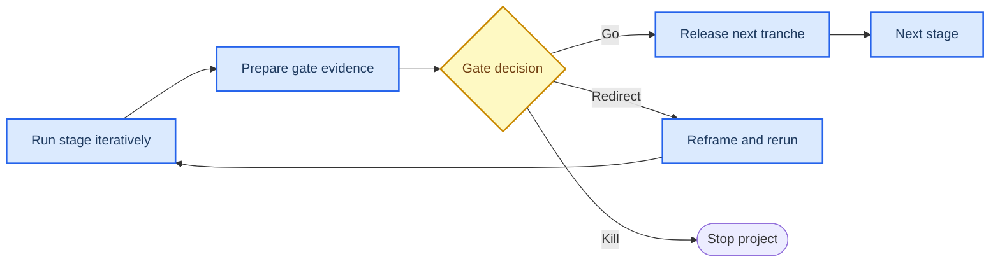

# Stage-Gate

Purpose: use decision gates between stages to control investment, while keeping the work inside each stage iterative.

## Definition and origin

Stage-gate (or phase-gate) splits a project into stages, each ending in a gate where stakeholders decide whether to continue, redirect, or stop. The gate is a **management decision point**, not a phase of technical work. Robert Cooper's Stage-Gate method made the model popular in product development; in software it is often combined with iterative delivery inside stages.

The gate is the defining element. Without an explicit kill or redirect decision, a "gate" is only a status meeting. With one, the model controls risk and exposure by limiting how much is invested before evidence exists.

## When it fits

- Investment is released in tranches and each tranche needs a go/no-go decision.
- Several projects compete for limited funding and must be compared at decision points.
- External approval, procurement or compliance milestones define when work may proceed.
- The cost of continuing in the wrong direction is high.

It is a poor fit when decisions cannot be made on evidence, when gates become ceremonial sign-offs, or when the work is small enough that the decision overhead dominates.

## How it works

1. **Define stages** (discover, design, build, validate, launch) with concrete deliverables.
2. **Define gates** with criteria, evidence required, decision makers, and the three outcomes: go, redirect, kill.
3. **Run the stage iteratively:** plan slices, build, test, and demo inside the stage.
4. **Prepare the gate pack from the slices:** working behaviour, acceptance tests, metrics and a named decision.
5. **Decide at the gate**, record the reason, and release the next tranche only if the criteria are met.
6. **Keep gates few**; too many turn a decision process into paperwork.

## Strengths and failure modes

| Strength | Failure mode | Symptom / correction |
|---|---|---|
| Explicit kill decisions limit sunk cost | Gates as rubber stamps | Every project passes; require evidence and a named decider |
| Investment is tied to evidence | Gate criteria invented at the meeting | Publish criteria when the stage starts |
| Competing projects can be compared | Overloaded gate calendar | Managers spend all week in reviews; reduce gate count |
| Clear alignment with funding cycles | "Gate" mistaken for a technical phase | Stage becomes "design stage", work stalls; iterate inside the stage |
| Stakeholders see progress at decision points | Document-only packs | Slides replace working software; demo from the slice's acceptance test |

## Mapping to vertical slices

- A gate is a **phase boundary** in the roadmap; a stage contains one or more capability slices.
- Each slice that touches a gate criterion produces the evidence for that criterion — a test run, a demo, a metric.
- Keep gate packs small: one row per criterion with slice, evidence, verifier, decision.
- Do not create a phase whose only deliverable is the gate pack; fold the evidence work into the slice it describes.
- Because gates decide *when* you may proceed, use slices to make the decision cheap and reversible rather than final.

## Verification questions

1. Can each gate actually kill or redirect a project, or only approve it?
2. Were the gate criteria published before the stage began?
3. Does the gate pack contain working behaviour and tests, or only documents?
4. How many gates does a small project face, and is that overhead justified?
5. Is the work inside each stage iterative and slice-based?

## External References

| Source | What to consult it for | URL |
|--------|------------------------|-----|
| Wikipedia — Phase-gate process (index only) | Stage-gate history, decision points and typical criteria | https://en.wikipedia.org/wiki/Phase-gate_model |
| Stage-Gate International — Robert G. Cooper's method | Originating method, gate criteria and product-development practice | https://www.stage-gate.com/ |
| Wikipedia — Waterfall model (index only) | How stage-gate relates to sequential lifecycle models | https://en.wikipedia.org/wiki/Waterfall_model |
| National Research Council (2010), DoD software acquisition | Decision milestones in large acquisition programs and criticism of rigid gates | https://www.nationalacademies.org/read/12823/chapter/5 |
