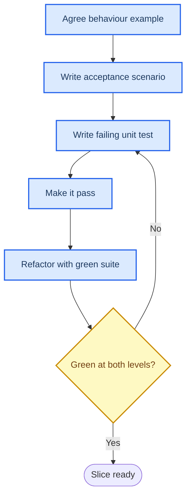

# TDD and BDD

Purpose: use test-first development at two levels — unit-level TDD for logic and BDD for shared, behaviour-level acceptance criteria.

## Definition and origin

Test-driven development (TDD) is the practice of writing a failing test before the code that satisfies it, then refactoring: red, green, refactor. Behaviour-driven development (BDD) extends the idea with a shared, example-based language for describing behaviour, often in Given/When/Then form, so that developers, testers and business stakeholders can agree on what "done" means before implementation.

Both are associated with Extreme Programming and with the agile community; Martin Fowler's bliki and the Agile Alliance glossary provide widely cited definitions. They are engineering practices rather than full project methodologies, grouped here because they share the same test-first loop and because a vertical slice's definition of done depends on them.

## When it fits

- Logic can be specified by examples and verified automatically.
- The team needs a shared language for acceptance criteria.
- Changes are frequent, so a regression suite is worth maintaining.
- Stakeholders can review concrete examples rather than prose requirements.

It is a poor fit when the outcome cannot be observed automatically, when examples cannot be agreed, or when the team treats the test suite as an end in itself.

## How it works

1. **Describe the behaviour** as an example: Given a context, When an event occurs, Then an observable outcome.
2. **Write the smallest failing test** that expresses it — unit-level for TDD, acceptance-level for BDD.
3. **Make it pass** with the simplest implementation that satisfies the test.
4. **Refactor** while the suite stays green; keep tests as executable documentation.
5. **Use collaboration** to discover the examples: BDD is as much a conversation as a file format.
6. **Keep the suite meaningful:** replace brittle assertions when behaviour changes, and pin every escaped defect.

## Strengths and failure modes

| Strength | Failure mode | Symptom / correction |
|---|---|---|
| Tests document real behaviour | Tests mirror implementation | Green suite, wrong product; assert through the public boundary |
| Failures are localised | Giant acceptance tests | One failure, no clue where; layer focused slice tests underneath |
| Shared examples reduce misunderstanding | BDD written only by developers | Stakeholders cannot recognise the scenarios; hold the conversation |
| Refactoring becomes safe | Rushing to green with bad code | Coverage high, design poor; keep the refactor step explicit |
| Regression pins prevent repeats | Pinning every trivial bug forever | Slow suite; keep pins for defects that matter |

## Mapping to vertical slices

- Write the slice's **acceptance test first**; that test is the demo script and definition of done.
- Use BDD scenarios for the capability ("an approver can approve an invoice") and TDD for the rules inside the slice.
- Keep the test pyramid scaled to risk: acceptance test through the public boundary, focused slice tests for logic, contract tests for shared boundaries.
- A scenario that needs several capabilities to pass is a sign the slice is too large; narrow it.
- Regression pins belong to the slice that fixed the defect, not to a generic "test suite" phase.

## Verification questions

1. Was the acceptance test written before the code?
2. Can a stakeholder read the scenario and recognise the capability?
3. Do the tests assert observable behaviour rather than implementation details?
4. Is there a refactor step after green, or does code accumulate?
5. Did the last escaped defect produce a focused regression pin?

## External References

| Source | What to consult it for | URL |
|--------|------------------------|-----|
| Martin Fowler — Test Driven Development | TDD definition and the red-green-refactor loop | https://martinfowler.com/bliki/TestDrivenDevelopment.html |
| Wikipedia — Test-driven development (index only) | TDD history, process and criticism | https://en.wikipedia.org/wiki/Test-driven_development |
| Wikipedia — Behavior-driven development (index only) | BDD origins, Given/When/Then and relation to TDD | https://en.wikipedia.org/wiki/Behavior-driven_development |
| Agile Alliance — What is BDD? | Community definition and collaboration aspects of BDD | https://www.agilealliance.org/glossary/bdd/ |
