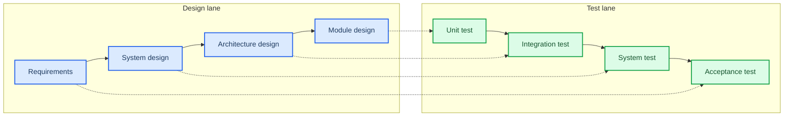

# V-Model

Purpose: understand the verification-and-validation counterpart to waterfall and how to use its test-pairing idea without shipping a document-only project.

## Definition and origin

The V-model bends the second half of the waterfall upward so that each development activity on the left leg has a corresponding test activity on the right leg: requirements pair with user acceptance testing, architecture with integration testing, module design with unit testing. The horizontal axis is time or completeness; the vertical axis is abstraction. It is an extension of waterfall, not a fundamentally different lifecycle.

The software V-model is one reading of a broader systems-engineering "vee" used in German government projects (*V-Modell*), testing curricula, and US government standards. SEI's Donald Firesmith notes that the traditional V-model is a useful simplification but a gross one: real activities occur iteratively and concurrently, and he offers single, double, and triple V variants that show executable work products and their tests explicitly.

## When it fits

- Requirements are stable and testable before implementation starts.
- Failure is expensive: regulated devices, safety systems, contractual acceptance.
- An auditor or customer needs traceability from requirement to test to result.
- The team can plan test levels early and keep test artifacts current as design changes.

It is a poor fit when requirements are discovered by use, when test plans are written once and then ignored, or when a fixed delivery date squeezes testing into the final window.

## How it works

1. **Left leg — decomposition:** requirements analysis, system design, architecture design, module design.
2. **Pair each level with a test plan as the artifact is created:** acceptance plan with requirements, system test plan with system design, integration plan with architecture, unit plan with module design.
3. **Right leg — integration and validation:** unit, integration, system, and user acceptance testing, each verifying the corresponding left-leg artifact.
4. **Keep verification and validation distinct:** verification asks "are we building it right?" (conformance to specification); validation asks "are we building the right thing?" (fit to real user needs).
5. **Let tests move earlier** where models are executable: a tester's double V tests executable requirements and designs before they become code.

## Strengths and failure modes

| Strength | Failure mode | Symptom / correction |
|---|---|---|
| Every design artifact has a planned test | Rigid artifact-to-test coupling | Tests check what the document says, not what users need; add exploratory testing |
| Early test planning finds specification defects sooner | Testing squeezed at the end | Overruns compress the right leg; treat test windows as gate evidence, not slack |
| Clear traceability for audits and certification | False sense of rigour | The diagram is mistaken for a complete process model; keep it an abstraction |
| Verification and validation are named separately | Confusing the two | "All tests pass" while users reject the product; run acceptance with realistic data |
| Scales to safety-critical systems with formal V-Modell variants | Unchanged waterfall risks | Late feedback and integration cliff remain; slice inside each gate interval |

## Mapping to vertical slices

- A slice inherits the **test pairing** idea: its acceptance test is planned with the capability, not after the code exists.
- Keep the pairing light: one acceptance test through the public boundary and a few focused slice tests, rather than a document per design level.
- Map test levels to slice concerns: unit tests for slice rules, integration tests for touchpoints, system/acceptance tests for the capability, negative paths for validation of user need.
- For regulated work, attach the V-model traceability to the slice's evidence pack; the slice, not a standalone test phase, produces the auditable artifact.
- Avoid the V-model failure mode by letting the right leg run inside every slice instead of once at project end.

## Verification questions

1. Is each planned test tied to a capability or slice, or only to a document?
2. Can a verifier distinguish verification from validation in your acceptance evidence?
3. Did test planning happen when the requirement was written, or after implementation was frozen?
4. Is the right leg still visible when the schedule slips?
5. Are executable models or prototypes used to test the left leg early where that is cheaper?

## External References

| Source | What to consult it for | URL |
|--------|------------------------|-----|
| CMU SEI — Using V Models for Testing | Traditional, tester's double and triple V variants; strengths and oversimplification | https://www.sei.cmu.edu/blog/using-v-models-for-testing/ |
| Wikipedia — V-model (software development) (index only) | Phase-to-test pairing, criticism and current use in regulated industries | https://en.wikipedia.org/wiki/V-model_(software_development) |
| Wikipedia — V-model (index only) | Systems-engineering vee, V-Modell, and verification versus validation definitions | https://en.wikipedia.org/wiki/V-Model |
| Wikipedia — Verification and validation (index only) | Distinction between building the product right and building the right product | https://en.wikipedia.org/wiki/Verification_and_validation |
