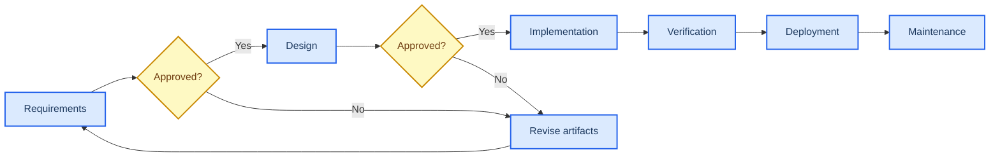

# Waterfall

Purpose: explain the sequential, plan-driven model, its gates, and where it honestly beats slicing.

## Definition and origin

Work moves through sequential phases — requirements, design, implementation, verification, deployment, maintenance — and each phase completes and signs off before the next begins. **Cascade** is the same shape with formal approval at each gate; the gate, not the sequence, is the defining feature.

The model is usually credited to Winston Royce's 1970 paper, but the attribution is ironic. Royce described the linear flow to show why it was "risky and invite[s] failure" when testing happens only at the end, then recommended documentation, doing the job twice, and involving the customer. The flawed diagram became the model; the fixes did not. Both the National Academies and Atlassian note this history.

## When it fits

| Condition | Why sequential wins |
|---|---|
| Scope is fixed and priced | Fixed-price contracts and tenders need a frozen baseline before spending |
| Requirements are stable and knowable | Protocols and interfaces defined by another party leave little to discover |
| Gates are external and mandatory | Certification, safety cases, accreditation and audits need a signed artifact at a defined moment |
| Change cost is asymmetric | Safety-critical firmware and destructive migrations make a late wrong turn unrecoverable |
| Work is genuinely repeatable | The same system has been built before and every requirement is known |

When these conditions hold, waterfall makes the commit point explicit. Slicing would move commitment later, which is exactly what the contract forbids.

## How it works

1. **Baseline the requirements** and freeze the parts the gate requires frozen.
2. **Design against the baseline**, producing the artifacts the next phase consumes.
3. **Implement and hand over** with traceability from requirement to artifact.
4. **Verify at the end of the interval**, then deploy and maintain.
5. **Hybrid when gates and short loops collide**: keep the external gate, plan vertical slices inside the interval, and bring *working behaviour plus tests* to the gate rather than documents alone. Freeze only the interface the gate actually needs.

A gate evidence pack should name, per gate: the artifact, the slice that produced it, the verifier, and the decision recorded. If the verifier can run the test, the evidence is stronger than a report about the test.

## Strengths and failure modes

| Strength | Failure mode | Symptom / correction |
|---|---|---|
| Explicit, priced commit point | Requirements fiction | Sections assert knowledge nobody has; mark assumptions and schedule the slice that tests them |
| Clear structure and documentation | Documentation as progress | Green status with nothing runnable; make each phase end in a demoable capability |
| Good for fixed interfaces across many teams | Integration cliff | Components meet at verification; integrate each slice with what already exists |
| Predictable cost and schedule when scope is stable | Late feedback | "That is not what we meant" at user acceptance; shorten the loop inside gate intervals |
| Strong traceability for audits | Risk back-loaded | The last 20% takes 60% of the schedule; schedule the riskiest slice first |
| Replicable process | Change resistance | Defects logged as "out of scope"; publish a priced change procedure |

## Mapping to vertical slices

- A phase becomes a **gate interval**; inside it, plan one or more capability slices. Never name the phase after a waterfall stage.
- The slice that touches a gated boundary carries the evidence: acceptance test, negative path, and rehearsed rollback.
- High blast radius raises the quality bar, not the phase count: more verification per slice, smaller slices, explicit down-migration.
- Where a gate genuinely requires a complete hazard analysis before code, make that analysis a task inside the slice it protects.
- Record which requirements are frozen and which stay revisable between gates; the frozen set should be minimal.

## Verification questions

1. Can every phase be traced to a gate or to a capability? If neither, delete it.
2. Is any baseline requirement actually an assumption? Which slice tests it first?
3. Can the verifier reproduce each piece of gate evidence by running a test?
4. If scope changes after gate one, is there a priced procedure?
5. Does any gate freeze an internal implementation detail rather than an interface?

## External References

| Source | What to consult it for | URL |
|--------|------------------------|-----|
| National Research Council (2010), DoD software acquisition | Origin of the model, documented criticism, preference for iterative-incremental development | https://www.nationalacademies.org/read/12823/chapter/5 |
| Atlassian — Waterfall methodology | Phases, benefits, limitations and when the sequential model fits | https://www.atlassian.com/agile/project-management/waterfall-methodology |
| Wikipedia — Waterfall model (index only) | Historical summary, modified waterfall variants, Royce's actual recommendation | https://en.wikipedia.org/wiki/Waterfall_model |
| Agile Manifesto | Value contrast: responding to change over following a plan | https://agilemanifesto.org/ |
