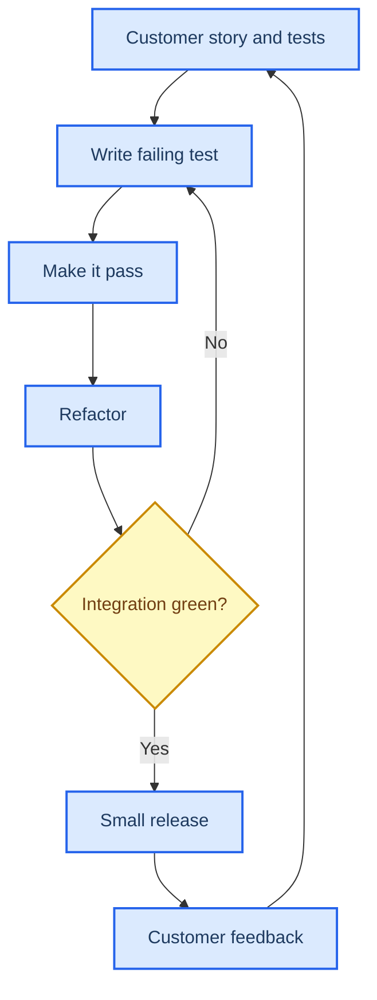

# Extreme Programming

Purpose: adopt the engineering practices that make short cycles safe — test first, pair, integrate continuously and keep the design simple.

## Definition and origin

Extreme Programming (XP) is an agile framework created by Kent Beck in the late 1990s, described in *Extreme Programming Explained* and on the community site extremeprogramming.org. It takes twelve practices to the extreme: pair programming, planning games, frequent releases, customer tests, continuous integration, test-driven development, small releases, simple design, refactoring, collective ownership, continuous integration and sustainable pace.

XP is the most engineering-focused agile framework. Where Scrum says *what* events to hold, XP says *how* to build the software so that changing it stays cheap. Agile Alliance's XP glossary and Wikipedia provide accessible summaries; the community site preserves the original explanations.

## When it fits

- Requirements change frequently and the cost of change must stay low.
- The team is small, co-located or closely collaborating, and can pair.
- Automated tests and continuous integration are feasible.
- A customer representative is available to write or confirm acceptance tests.

It is a poor fit when pairing is culturally unacceptable, when the system cannot be tested automatically, or when a customer surrogate is unavailable.

## How it works

1. **Planning game:** customers decide scope and priority; developers estimate and commit to small increments.
2. **Small releases:** ship a usable increment frequently, often every one to three weeks.
3. **Customer tests:** acceptance tests are specified before the story is built.
4. **Test-driven development:** write a failing test, make it pass, refactor.
5. **Pair programming and collective ownership:** two people per workstation, anyone can change any code.
6. **Continuous integration:** integrate and run the full test suite several times a day.
7. **Simple design and refactoring:** do the simplest thing that works, then remove duplication and improve the design continuously.
8. **Sustainable pace:** overtime is a signal of a problem, not a tool.

## Strengths and failure modes

| Strength | Failure mode | Symptom / correction |
|---|---|---|
| Tests make change safe | Test suite that asserts implementation | Tests pass while behaviour is wrong; write customer-facing assertions |
| Continuous integration removes integration cliff | Long-lived branches | Merge pain at release; integrate to main daily |
| Pairing spreads knowledge | Pairing as surveillance | Resistance and fatigue; rotate pairs and keep it voluntary in spirit |
| Simple design plus refactoring avoids waste | Refactoring without tests | Regressions; keep the safety net green first |
| Customer tests keep the team honest | No available customer | Developers invent acceptance criteria; appoint a surrogate with authority |

## Mapping to vertical slices

- Each XP story is a **capability slice**: a test is written first, the code crosses every layer it needs, and the increment ships.
- Acceptance tests are the slice's definition of done; unit and contract tests localise failures inside it.
- Refactoring happens inside the slice, not in a separate hardening phase.
- Collective ownership applies to slice code; do not create a shared layer that must be coordinated before any slice can ship.
- Small releases mean the slice must be independently deployable and revertible.

## Verification questions

1. Is the acceptance test written before the story, and does it describe behaviour?
2. Does every commit run the full test suite?
3. Are refactors happening continuously with a green suite?
4. Is there a real customer or authorised surrogate for acceptance tests?
5. Is the team's pace sustainable without recurring overtime?

## External References

| Source | What to consult it for | URL |
|--------|------------------------|-----|
| Extreme Programming: A Gentle Introduction (community site) | Original explanations of the core practices | http://www.extremeprogramming.org/ |
| Agile Alliance — What is Extreme Programming (XP)? | Definition, values and practice summary | https://www.agilealliance.org/glossary/xp/ |
| Wikipedia — Extreme programming (index only) | History, the twelve practices and criticism | https://en.wikipedia.org/wiki/Extreme_programming |
| Wikipedia — Test-driven development (index only) | The red-green-refactor cycle XP depends on | https://en.wikipedia.org/wiki/Test-driven_development |
